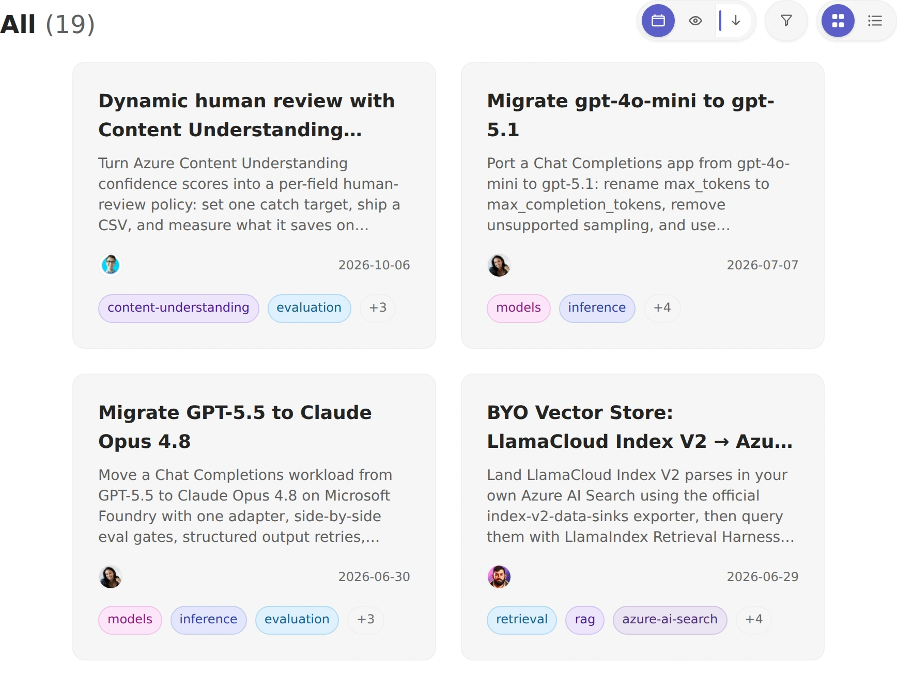

# Forgebook

**Find an AI pattern. Run the notebook. Build with [Microsoft Foundry](https://learn.microsoft.com/azure/foundry).**

Forgebook is a curated cookbook for developers building agents, retrieval,
model inference, and multimodal applications. Start with a concrete task,
follow a notebook, and adapt the pattern to your own application.

Recipe publishing is limited to internal Microsoft Foundry contributors.
External recipe submissions are not accepted.

**[Browse the recipe catalog](https://microsoft-foundry.github.io/forgebook/)**
&nbsp; / &nbsp; **[Open the notebooks](notebooks/)**

[](LICENSE)
[](notebooks/)

[](https://microsoft-foundry.github.io/forgebook/)

*Browse online to search, filter by topic, or switch between grid and list views.*

## Find your next pattern

These links open the published recipes on the Forgebook site.

| Your task | Start here |
| --- | --- |
| Reduce manual document review | [Calibrate per-field confidence cutoffs](https://microsoft-foundry.github.io/forgebook/notebook/acu-dynamic-hitl/) |
| Update a Chat Completions application | [Migrate gpt-4o-mini to gpt-5.1](https://microsoft-foundry.github.io/forgebook/notebook/migrate-gpt-4o-mini-to-gpt-5-1/) |
| Move a workload between model providers | [Migrate GPT-5.5 to Claude Opus 4.8](https://microsoft-foundry.github.io/forgebook/notebook/migrate-gpt-5-5-to-claude-opus-4-8/) |
| Keep your own vector store | [Connect LlamaCloud Index V2 to Azure AI Search](https://microsoft-foundry.github.io/forgebook/notebook/llamacloud-index-v2-azure-ai-search/) |
| Replace Azure OpenAI On Your Data | [Migrate to Foundry IQ](https://microsoft-foundry.github.io/forgebook/notebook/migrate-oyd-to-foundry-iq/) |

**New to agents?** Start with [Create Your First Agent](https://microsoft-foundry.github.io/forgebook/notebook/foundry-agent-part-1/),
then [connect tools and write your first code](https://microsoft-foundry.github.io/forgebook/notebook/foundry-agent-part-2/).
For shared tool definitions and governance, explore [Toolboxes in Microsoft Foundry](https://microsoft-foundry.github.io/forgebook/notebook/mastering-foundry-toolbox/).

## Run a recipe

Start with a recipe in the [online catalog](https://microsoft-foundry.github.io/forgebook/)
and follow its prerequisites. Python versions, dependencies, Azure resources,
and model access vary by recipe. Running a recipe can incur Azure charges;
review its requirements and pricing before executing it.

To open notebooks locally, [install uv](https://docs.astral.sh/uv/getting-started/installation/)
and create an isolated environment. This example uses Python 3.13; use the
version required by your selected recipe if it differs:

```bash
git clone https://github.com/microsoft-foundry/forgebook.git
cd forgebook
uv venv --python 3.13 --seed
source .venv/bin/activate
uv pip install -r requirements.txt
jupyter notebook
```

`--seed` provides pip inside the environment for existing notebook `%pip` setup
cells. The shared dependencies above are installed by uv.

On Windows, activate the environment with `.\.venv\Scripts\Activate.ps1` in
PowerShell instead. Open a file under `notebooks/` and follow its setup cells;
recipes may install additional dependencies. Keep any Azure credentials out of
notebooks and source control.

## Data Collection

The Forgebook public site uses standard pseudonymous web telemetry. Microsoft uses these insights only to improve Forgebook content, recipe planning, and site performance. By choosing to use the public site, you consent to this telemetry.

## Resources and support

- [Microsoft Foundry documentation](https://learn.microsoft.com/azure/foundry/what-is-foundry)
- [Foundry models](https://learn.microsoft.com/azure/foundry/concepts/foundry-models-overview)
- [Foundry Agent Service](https://learn.microsoft.com/azure/foundry/agents/overview)
- [Support](SUPPORT.md) / [Report a security vulnerability](SECURITY.md)

This project follows the [Microsoft Open Source Code of Conduct](CODE_OF_CONDUCT.md).

## License

[MIT](LICENSE)
