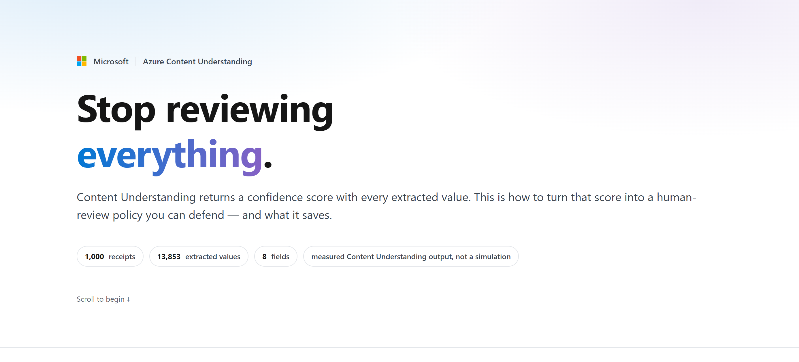
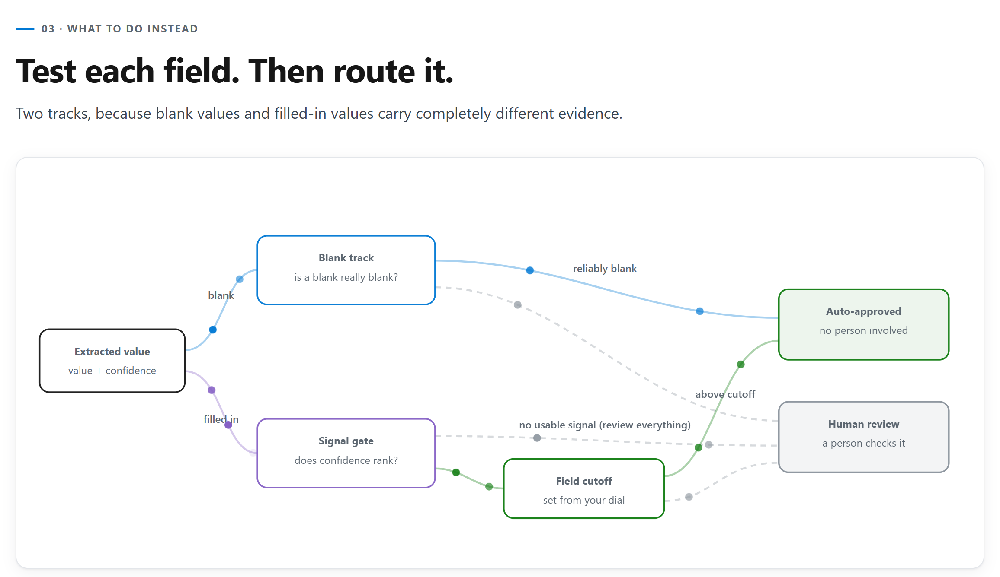

You used to key document data into your system by hand. Then you automated extraction with Azure Content Understanding, but a person still reviews every extracted value. That feels safe, but it's slow and expensive, and it keeps much of the manual work you meant to remove.

What if Content Understanding could tell you how confident it is in each value, so a person only checks the ones worth checking? It can: each extracted value can come back with a confidence score. But one cutoff shared by every field is a blunt tool, because a score you can trust for one field can mean very little for another. This recipe gives each field its own cutoff instead, all set by one dial: **the share of mistakes human review must catch**. Fields whose confidence can't tell correct values from mistakes get no cutoff and stay in review.

Blank values get their own rule. When Content Understanding returns nothing for a field, the confidence attached is a fixed placeholder, so the recipe ignores it and instead approves or reviews each field's blanks based on how often they turn out to be truly blank.

The recipe runs on 1,000 receipts from the public [CORD v2](https://huggingface.co/datasets/naver-clova-ix/cord-v2) dataset, already processed by Content Understanding and checked against the dataset's correct answers, so every mistake is known. You tune on 800 receipts and test on the other 200.

With the dial at 80%, the policy approves **25% of the test values without review** and still catches **87% of the mistakes**, beating the target, and 10% of what it approves is wrong. A single 0.80 cutoff on every value approves a little more (30%), but catches only 71% of mistakes, and 18% of what it approves is wrong, nearly double the policy's 10%. More than half the saving comes from handling blanks this way, and each per-field cutoff is set so that field meets your dial with 95% confidence. What you ship is a small CSV with one row per field, and routing a new value is a dictionary lookup and a comparison.

[](media/acu-dynamic-hitl/dynamic-hitl-explainer.html)

**[Open the interactive explainer](media/acu-dynamic-hitl/dynamic-hitl-explainer.html)** for a six-part visual walkthrough of the method, driven by the same numbers this notebook computes on the bundled receipts.

## Background

[Azure Content Understanding](https://learn.microsoft.com/azure/ai-services/content-understanding/overview) is a Foundry Tool that uses generative AI to turn unstructured content into structured output. For document processing, you define an analyzer's field schema, such as an invoice number and total amount, and the analyzer extracts those values. You can use the output in automation or analytics, for tasks such as invoice processing or contract analysis.

For documents, you can enable [confidence scores and grounding](https://learn.microsoft.com/azure/ai-services/content-understanding/concepts/analyzer-reference#estimatefieldsourceandconfidence) with `estimateFieldSourceAndConfidence`. A score from 0 to 1 estimates an extracted value's accuracy; higher means more confidence. Grounding shows where on the page the value came from so a reviewer can check it.

The common pattern, which Microsoft Learn suggests, is human-in-the-loop (HITL) review: values above a confidence threshold go straight into your systems without review, called straight-through processing (STP), and the rest go to a person for review. In the CORD receipt data this recipe uses, one threshold can't serve every field. Confidence is a useful guide for the receipt's total (`total_price`), but for its tax amount (`tax_price`) it isn't reliably better than chance.

### How the routing works

The recipe uses the checked values to tune a rule for each field, with separate paths for blank and filled-in values.



- **Blank values** are judged on one question per field: when Content Understanding returns nothing, is the field reliably blank? Content Understanding gives blanks a placeholder score, so no cutoff can sort them.
- **Filled-in values** must pass a signal gate first. A field earns a cutoff only if its confidence demonstrably ranks correct values above mistakes. Otherwise, every filled-in value in that field goes to review. The exception is a field with no mistakes in training data: with nothing to rank, it's judged like blanks, and its values skip review only if its accuracy clears the dial with 95% confidence.
- **Anything that fails either test goes to review.** Too little evidence means someone always needs to review, so confidence scores that aren't useful cost you savings instead of missing the mistakes.

## Overview

**Who this is for:** developers and data scientists running document extraction with Content Understanding who send every extracted value to a person for review today and want to be more strategic about what gets reviewed.

**What you'll learn:**

- Measure whether each field's confidence is worth trusting, instead of picking one global cutoff.
- Set one business dial and turn it into a per-field calibration table.
- Apply the saved table with the provided calibration library, then compare it against a shared cutoff on unseen documents.
- Configure a Content Understanding analyzer in Microsoft Foundry to return confidence scores, and flatten its output into calibration rows.

**Prerequisites:**

- Python 3.10 or later. Steps 1 through 6 run on bundled, measured Content Understanding output and **need no Azure credentials**.
- For the optional step 7: a Microsoft Foundry resource with Content Understanding, the **Cognitive Services User** role on it, default model deployments configured for Content Understanding, and the `CONTENTUNDERSTANDING_ENDPOINT` environment variable set.

**Time estimate:** about 10 minutes. Measuring the signal takes about a minute.

## Outline

1. Set up and load the data
2. Measure the signal in each field
3. Turn the business dial
4. Save the calibration table
5. Deploy it: route unseen documents
6. Bring your own data
7. Optional: get confidence-scored output from Content Understanding in Foundry

## 1. Set up and load the data

The recipe's helpers live next to the notebook in `data/acu-dynamic-hitl/`: the calibration library (`calibration.py`, `acu_calibrator.py`, `matching.py`), the mistake catch-rate dial renderer (`hitl_dial.py`), and the bundled data. Install the dependencies once.

```python
%pip install --quiet -r data/acu-dynamic-hitl/requirements.txt
```

The bundled dataset is **measured** Content Understanding output for 1,000 [CORD v2](https://huggingface.co/datasets/naver-clova-ix/cord-v2) receipts (CC BY 4.0), not a simulation. It has one row per extracted field value: what Content Understanding returned, its confidence, and whether it matched ground truth. 800 documents calibrate the policy and 200 are held out to test it.

```python
import sys

sys.path.insert(0, "data/acu-dynamic-hitl/")

import matplotlib.pyplot as plt
import pandas as pd
from IPython.display import HTML, display

import calibration as calib
import matching
import hitl_dial

pd.set_option("display.width", 160)
pd.set_option("display.max_columns", 40)
# Jupyter right-aligns table values to match pandas' headers; do the same in renderers that don't.
display(HTML("<div><style>.dataframe td { text-align: right; } .dataframe tbody th, .dataframe thead th:first-child { text-align: left; }</style></div>"))

data = calib.load_demo_data("data/acu-dynamic-hitl/cord_demo.parquet")
documents = data.groupby("split")["document_id"].nunique()

print(f"{len(data):,} extracted field values")
print(f"{documents['train']:,} documents to calibrate on, {documents['test']:,} held out\n")
data[["document_id", "split", "field_name", "extracted_value", "confidence", "is_correct"]].head(3)
```

The baseline everyone starts from: **every value is reviewed by a person**, to find the mistakes hiding among them.

```python
train = calib.calibration_input(data, split="train")
mistakes = int((~train["is_correct"].astype(bool)).sum())

print(f"Training split: {len(train):,} values, {mistakes:,} of them wrong ({mistakes / len(train):.1%})")
```

## 2. Measure the signal in each field

**When to use:** once per document type, on labeled documents.

**What it does:** for each field, it bootstraps a confidence interval on AUC by resampling whole receipts, so line items from one receipt stay together, measures how often a blank is genuinely blank, and sweeps every candidate cutoff. Everything is cached, so changing the target later costs nothing.

**How to read it:**

- **`auc`**: how often confidence puts a correct value above a wrong one. 0.5 is a coin flip.
- **`confidence_is_usable`**: the field earns a cutoff only if the *lower* end of its AUC interval clears the 0.5 cutoff.
- **`blank_precision`**: how often a receipt's blanks for this field really are blank. Each receipt counts once, because line items from one receipt aren't independent evidence. Its lower bound decides whether blanks can skip review.

**How to adapt:** the AUC bar is `calib.MIN_AUC_CI_LOWER` (default 0.50, the loosest bar that still beats a coin flip). Set it before fitting, for example `calib.MIN_AUC_CI_LOWER = 0.55`, then re-run this cell.

By default each field's raw confidence is thresholded. If you expect to add other predictors of correctness later, such as contrast or sharpness ratios, fit with `score_mode="logistic"` instead: `calib.fit_base_policies(data, split="train", score_mode="logistic")`. That fits a one-variable logistic regression (Platt scaling) that maps confidence to `P(correct)`. With confidence alone it routes exactly like the raw cutoff, so nothing changes today. That relies on a positive slope, so a field whose fitted slope isn't positive goes to review: if higher confidence means a value is *less* likely to be correct, something is wrong upstream, and following the fit would flip the ranking.

```python
base_policies = calib.fit_base_policies(data, split="train")

calib.signal_frame(base_policies).set_index("field_name")[
    ["n_filled", "auc", "auc_ci_lower", "confidence_is_usable", "n_blank", "blank_precision", "blank_ci_lower"]
].round(3)
```

Five of the eight fields carry usable signal. `menu.quantity`, `other_adjustment`, and `tax_price` do not: their AUC interval reaches below 0.5, so their filled-in values stay in full review no matter where you set the dial.

## 3. Turn the business dial

**When to use:** whenever the business changes how much risk it accepts.

**What it does:** one number, `TARGET`, is the minimum share of known mistakes review must catch. Each field gets the least-review cutoff whose catch rate meets that floor with 95% confidence, so a field with few known mistakes gets a safer cutoff or stays in review. Nothing is refit; the cached signal is reused. Think of this dial as the business's risk tolerance; turn it up to prevent more mistakes from slipping past review, or dial it back to automate more at the cost of more errors.

**How to adapt:** change `TARGET` and re-run from here. To vary it per field, pass a mapping that covers every field, for example `{**{field: TARGET for field in base_policies}, "total_price": 0.95}`.

`TARGET` is a floor on the fields that earn a cutoff, not a portfolio promise, and not a promise that auto-approved values are `TARGET` correct. Those are different denominators. Step 5 measures both on unseen documents.

```python
TARGET = 0.80

policies = calib.select_policies(base_policies, TARGET)
calib.calibration_table(policies)[
    ["field_name", "filled_decision", "cutoff", "blank_decision", "target_catch_rate", "min_null_precision"]
].round(3)
```

In the table, `filled_decision` is `calibrate` when a field earned a cutoff and `always_review` when it didn't. It can also be `always_trust`, for a field with no mistakes in training data whose accuracy clears the dial. `blank_decision` says what happens when Content Understanding returns nothing for the field: `null_to_stp` approves the blank without review (straight-through processing), and `null_to_hitl` sends it to a person for review (human in the loop). Blanks need more evidence as the dial rises: even when every training blank is genuinely blank, a field needs blanks on 16 receipts to clear 0.80 and on 73 to clear 0.95. That's why `menu.name`, with blanks on only 8 receipts, sends its blanks to review.

Where the saving comes from, on the training split:

```python
per_field, portfolio = calib.savings_attribution(policies, train)

print(f"Review avoided at the {TARGET:.0%} target: {portfolio['hitl_savings_pct']:.1%}")
print(f"  from blank values:     {portfolio['null_savings_pct']:.1%}")
print(f"  from filled-in values: {portfolio['lr_savings_pct']:.1%}")

per_field[["field", "bucket", "n_total", "null_savings", "lr_savings", "expected_hitl", "hitl_savings_pct"]].round(3)
```

Splitting blanks from filled-in values does more than half the work. Fields like `service_price` and `other_adjustment` are blank on most receipts, and their blanks are reliable, so most of their values never need a person to review them.

### Try every target at once

The dial below is precomputed from the same `base_policies` at 11 targets. The top half shows expected savings on the training split. **Caught on unseen documents** and **Slipped through** are measured on the 200 held-out receipts. Pick a target to compare.

```python
positions = hitl_dial.dial_positions(base_policies, data)
display(HTML(hitl_dial.render_dial(positions, default=TARGET)))
```

The dial is a real tradeoff. Ask reviews to catch more and you give up automation, mostly on the filled-in track, because the blank track is a per-field on/off switch rather than a sliding cutoff. The same tradeoff across the full range:

```python
sweep = calib.savings_sweep(base_policies, train, start=0.50, end=0.99, step=0.01)

fig, ax = plt.subplots(figsize=(9, 4.5))
ax.stackplot(
    sweep["target"],
    sweep["null_savings_pct"],
    sweep["lr_savings_pct"],
    sweep["hitl_load"],
    labels=["Blank (auto-approved)", "Filled-in (auto-approved)", "Still reviewed"],
    colors=["#0078d4", "#107c10", "#c7cdd4"],
)
ax.axvline(TARGET, color="#d13438", linestyle="--", linewidth=1.5)
ax.set_xlim(0.50, 0.99)
ax.set_ylim(0, 1)
ax.set_xlabel("Share of mistakes review must catch")
ax.set_ylabel("Share of all field values")
ax.set_title("Where the review load goes, across the range of targets")
ax.legend(loc="center left", bbox_to_anchor=(1.01, 0.5), frameon=False)
fig.tight_layout()
display(HTML(hitl_dial.figure_html(
    fig,
    alt=(
        "Stacked area chart of where the review load goes as the catch target rises from 50% to 99%: "
        f"blank values auto-approved, filled-in values auto-approved, and values still reviewed. "
        f"At the {TARGET:.0%} target, {portfolio['hitl_savings_pct']:.0%} of values skip review."
    ),
)))
```

## 4. Save the calibration table

The table is the calibration deliverable: one row per field with the decision, the cutoff, the targets it was calibrated to, and a plain-English `why`. Production needs this file and nothing else from calibration. Each run rewrites it with a new `calibrated_at` timestamp.

Here are its main columns, read back from the saved file. The file also carries `score_mode`, the two targets, `calibrated_at`, and `lr_coef` and `lr_intercept`, which stay empty in the default raw-confidence mode and hold the fitted curve in logistic mode.

```python
TABLE_PATH = f"data/acu-dynamic-hitl/calibration_table_{round(TARGET * 100)}pct.csv"

saved = calib.save_calibration_table(policies, TABLE_PATH)
print(f"wrote {saved.as_posix()}  ({saved.stat().st_size:,} bytes)")

table = pd.read_csv(saved, index_col="field_name")
table["cutoff"] = table["cutoff"].round(3)  # display only; the file keeps full precision
table[["filled_decision", "cutoff", "blank_decision", "why"]].fillna("")
```

> **Caution:** A calibration table only applies to what it was calibrated on: the same analyzer, model, and type of documents. A receipt table shouldn't route invoices, and a table calibrated on synthetic or unrepresentative data shouldn't route real production data. Calibrate on real, representative production data, and recalibrate when the analyzer, model, or documents change.

## 5. Deploy it: route unseen documents

Reload the saved CSV and apply its decisions to the 200 held-out receipts (2,617 values). This is the production path: `calib.route_frame` needs only `field_name`, `extracted_value`, and `confidence`, not ground truth or `split`. Here, labels and the test split measure outcomes, not choose decisions.

The STP error rate (`stp_error_rate`) is the share of auto-approved values, those sent straight through without review (STP), that turn out wrong. Read it per field and not just portfolio-wide. The dial controls how many mistakes review catches. It doesn't cap this rate, and the rate can vary by field.

Content Understanding never returned 8 line items in 7 documents (21 mistakes). The last results line reports them separately and the figures exclude them, because there is no extracted value to route. Value-level review can't catch them, so adding a document-level check (such as comparing summed item prices with the subtotal) could help with situations like these.

> **Important:** If the data you extract is sensitive, ensure a person still reviews every value and use this policy to set priorities instead of skipping review. Send every value to your human-in-the-loop review tool, using `route_to_hitl` and `route_reason` from `route_frame` only as priority labels. Reviewers work the flagged values first, then confirm the rest faster. They still see everything, and calibration shows where mistakes are most likely.

```python
shipped = calib.load_calibration_table(TABLE_PATH)

routed = calib.route_frame(data, shipped, split="test")
held_out, totals = calib.held_out_metrics(routed)

missed = calib.missed_line_items(data, split="test")
print(
    f"On {routed['document_id'].nunique()} unseen documents ({totals['field_values']:,} values):\n"
    f"  auto-approved:            {totals['auto_approve_rate']:.1%}\n"
    f"  mistakes caught:          {totals['catch_rate']:.1%}  (asked for {TARGET:.0%})\n"
    f"  STP error rate:           {totals['stp_error_rate']:.1%}\n\n"
    f"Line items never extracted (reported separately): {missed['items']} in {missed['documents']} documents, "
    f"{missed['mistakes']} mistakes"
)

held_out.set_index("field_name")[
    ["auto_approve_rate", "catch_rate", "stp_error_rate", "mistakes_caught", "total_mistakes"]
].round(3)
```

Every routed value carries a `route_reason`, so any decision can be explained after the fact and checked against ground truth:

```python
audit = (
    routed.groupby("route_reason")
    .agg(
        values=("is_correct", "size"),
        sent_to_review=("route_to_hitl", "sum"),
        mistakes=("is_correct", lambda s: int((~s.astype(bool)).sum())),
        stp_errors=("stp_error", "sum"),
    )
    .sort_values("values", ascending=False)
)
audit
```

### Route without labels

In production you have only the extraction and its confidence. Drop the labels and the split, and `route_frame` still routes every value. Use `route_to_hitl` and `route_reason` in your review workflow. A filled-in value with no confidence goes to review, and blanks ignore confidence and use the table's per-field blank decision.

```python
# Production input: only the extraction and its confidence. No labels, no split.
extractions = routed[["document_id", "field_name", "extracted_value", "confidence"]]
decisions = calib.route_frame(extractions, shipped)

same = (decisions["route_to_hitl"] == routed["route_to_hitl"]).all()
print(f"Same decisions as the labeled run above: {same}")
decisions[["field_name", "extracted_value", "confidence", "route_to_hitl", "route_reason"]].head()
```

### Compare against one shared cutoff

Compare the per-field policy with one 0.80 confidence cutoff on every value, including blanks, using the same held-out documents.

> **Important:** This cutoff is a comparison baseline, not a recommended routing policy. We do not recommend a shared raw-confidence threshold across fields, especially for blanks (nulls): their fixed placeholder scores say nothing about correctness. Route blanks using measured per-field null precision. This comparison only shows what calibration adds.

```python
def outcome(frame, approved):
    wrong = ~frame["is_correct"].astype(bool)
    return {
        "auto-approved": approved.mean(),
        "mistakes caught": (wrong & ~approved).sum() / wrong.sum(),
        "STP error rate": (wrong & approved).sum() / approved.sum(),
    }


confidence = pd.to_numeric(routed["confidence"], errors="coerce")
pd.DataFrame(
    {
        "one 0.80 cutoff on every value": outcome(routed, confidence >= 0.80),
        "per-field policy": outcome(routed, ~routed["route_to_hitl"].astype(bool)),
    }
).T.round(3)
```

The shared cutoff auto-approves a little more (29.6% against 25.1%), but it catches 70.5% of mistakes against 86.6% and has an STP error rate of 18.0% against 9.6%. One cutoff treats every field the same, even though the same confidence score can mean different things in different fields. It also trusts the placeholder scores on blanks, fixed in this data at 0.855 for line-item fields and 0.614 for single-value fields. At 0.80, every line-item blank is auto-approved (112 of 615 held-out blanks, 27 of those 112 wrong), while every single-value blank goes to review, even when a field's blanks are reliably blank.

### Does the dial behave like a dial?

Sweep every target, rebuilding on training documents only and measuring outcomes on untouched test documents. Green ("Fields given a cutoff") is the line the target governs. It tracks on or just above the diagonal: each cutoff has to clear the target with 95% confidence on training documents, and that margin absorbs most of the shift to unseen documents. Amber ("Everything together") runs higher because fully reviewed fields catch everything.

```python
tracking = calib.coverage_tracking(base_policies, data, split="test", step=0.05)

fig, ax = plt.subplots(figsize=(6, 5.5))
ax.plot([0.5, 1.0], [0.5, 1.0], "--", color="#94a3b8", label="Perfect tracking")
ax.plot(tracking["target"], tracking["overall_catch"], "o-", color="#ca5010", linewidth=2.5, label="Everything together")
ax.plot(tracking["target"], tracking["calibrated_catch"], "o-", color="#107c10", linewidth=2.5, label="Fields given a cutoff")
ax.set_xlabel("Mistakes you asked review to catch")
ax.set_ylabel("Mistakes it actually caught, on unseen documents")
ax.set_ylim(0, 1.02)
ax.legend(frameon=False, loc="lower right")
ax.set_title("Does the dial behave like a dial?")
fig.tight_layout()
display(HTML(hitl_dial.figure_html(
    fig,
    alt=(
        "Line chart of the share of mistakes caught on unseen documents against the target, from 50% to 95%. "
        "The line for fields given a cutoff tracks on or just above the diagonal; "
        "the line for all fields together runs above it."
    ),
)))
```

The margin is per field and set on training documents, so a single field can still land a point or two short on unseen documents: here `menu.price` catches 78.6% at the 80% dial. If one field must hold its target, raise that field's target with a per-field mapping from step 3.

## 6. Bring your own data

Everything above needs one table with these six columns, one row per extracted field value:

| column | meaning |
| --- | --- |
| `document_id` | which document the value came from |
| `split` | `train` or `test`; split by document, never by row |
| `field_name` | which field the value belongs to |
| `extracted_value` | what Content Understanding returned (`None` if nothing) |
| `confidence` | Content Understanding's confidence for that value, 0 to 1 |
| `is_correct` | whether it matched ground truth |

`matching.add_is_correct(frame)` fills in the last column by comparing `extracted_value` to a `ground_truth_value` column with per-field normalization. You define what "correct" means: too strict and you chase mistakes that were not mistakes; too loose and the policy certifies real ones. Build the frame from real, representative production documents, not synthetic ones, then point the notebook at it: in step 1, replace the `calib.load_demo_data(...)` line with `data = calib.load_canonical_file("my_data.parquet")` (Parquet or CSV), or assign your DataFrame to `data` directly. Restart the kernel and run all cells, so every result above, including the dial, is recomputed from your data instead of the receipts.

List fields, such as receipt line items, are named `<list>.<property>` (for example `menu.price`) and carry an `item_index`. Use `matching.pair_with_ground_truth` to pair items one-to-one by content within each document, not by position. Each item's `line_item_status` is `matched`, `missed` (in ground truth, never extracted), or `extra` (extracted, not in ground truth). Extra items count as mistakes; missed items are excluded from calibration and reported separately by `calib.missed_line_items`. Treat `weights` and `max_cost` as choices: check missed and extra counts, then spot-check pairs.

In the example below, `Iced tea` is `matched` even though it sits in a different position, `Coffee` is `missed`, and `Discount` is `extra`.

```python
# Extracted rows, for example from to_canonical_rows in step 7. Line items carry an item_index.
extracted = pd.DataFrame(
    [
        {"document_id": "receipt-1", "field_name": "total_price", "item_index": None, "extracted_value": "13.00", "confidence": 0.93},
        {"document_id": "receipt-1", "field_name": "menu.name", "item_index": 0, "extracted_value": "Iced tea", "confidence": 0.88},
        {"document_id": "receipt-1", "field_name": "menu.price", "item_index": 0, "extracted_value": "4.00", "confidence": 0.91},
        {"document_id": "receipt-1", "field_name": "menu.name", "item_index": 1, "extracted_value": "Discount", "confidence": 0.64},
        {"document_id": "receipt-1", "field_name": "menu.price", "item_index": 1, "extracted_value": "-1.00", "confidence": 0.70},
    ]
)
# Your labels for the same documents. Line items don't need to be in the same order as the extraction.
truth = pd.DataFrame(
    [
        {"document_id": "receipt-1", "field_name": "total_price", "item_index": None, "ground_truth_value": "13.00"},
        {"document_id": "receipt-1", "field_name": "menu.name", "item_index": 0, "ground_truth_value": "Coffee"},
        {"document_id": "receipt-1", "field_name": "menu.price", "item_index": 0, "ground_truth_value": "9.00"},
        {"document_id": "receipt-1", "field_name": "menu.name", "item_index": 1, "ground_truth_value": "Iced Tea"},
        {"document_id": "receipt-1", "field_name": "menu.price", "item_index": 1, "ground_truth_value": "4.00"},
    ]
)

my_data = matching.pair_with_ground_truth(extracted, truth, weights={"name": 0.6, "price": 0.4})
my_data = matching.add_is_correct(my_data)
my_data["split"] = "train"  # assign splits by document, never by row
my_data
```

**How much labeled data?** When this training split was re-sampled at smaller sizes, the blank track qualified with 15 to 30 blanks per field, while the filled-in track needed a few hundred values to qualify dependably. Below a few hundred documents, *which* fields qualify is mostly noise. Fields that don't qualify route to full review, which is what you had before calibrating. Re-fit as labels accumulate.

## 7. Optional: get confidence-scored output from Content Understanding in Foundry

Confidence scores are **opt-in**. If your analyzer doesn't ask for them, extractions come back without a `confidence` and there is nothing to calibrate. Turn them on for every field with `estimateFieldSourceAndConfidence` in the analyzer `config`. The same flag returns grounding (page and bounding box), which shows a reviewer where each value came from.

`data/acu-dynamic-hitl/cord_receipt_v1.json` is the analyzer that produced the bundled receipts, and it works as a template. This step creates it in your Foundry resource, analyzes one public sample receipt, displays the extracted values and confidence scores as canonical rows, and deletes the analyzer. The sample demonstrates the extraction API; it isn't part of the CORD dataset, and no review policy is applied here. Calibrate on labeled examples of your own document type before using a policy on it.

**Before you run it:**

- Sign in with `az login`. The client uses `DefaultAzureCredential`.
- Assign yourself the **Cognitive Services User** role on the Foundry resource.
- Deploy the models Content Understanding needs (for example `gpt-4.1` and `text-embedding-3-large`) and set them as the resource defaults. See [Content Understanding client library: configure model deployments](https://learn.microsoft.com/python/api/overview/azure/ai-contentunderstanding-readme#step-3-configure-model-deployments-required-for-prebuilt-analyzers).
- Set `CONTENTUNDERSTANDING_ENDPOINT` to your resource endpoint, for example `https://<resource-name>.services.ai.azure.com/`.

**Cost:** one analyzed page, billed at Content Understanding rates plus the model tokens it uses.

If the variable isn't set, these cells print a skip message and the rest of the notebook is unaffected. The saved output below shows that skip path. The code targets `azure-ai-contentunderstanding` 1.1.

```python
%pip install --quiet "azure-ai-contentunderstanding>=1.1,<2" azure-identity
```

The analyzer nests fields (`menu` is an array of line items, `sub_total` and `total` are objects). The calibration works on flat field names, so this mapping and helper turn one analysis result into canonical rows: one per scalar field and one per line-item property.

```python
import os

CU_ENDPOINT = os.environ.get("CONTENTUNDERSTANDING_ENDPOINT")
RECEIPT_URL = (
    "https://raw.githubusercontent.com/Azure-Samples/"
    "azure-ai-content-understanding-assets/main/document/receipt.png"
)

SCALAR_FIELDS = {
    ("sub_total", "subtotal_price"): "subtotal_price",
    ("sub_total", "service_price"): "service_price",
    ("sub_total", "tax_price"): "tax_price",
    ("sub_total", "etc"): "other_adjustment",
    ("total", "total_price"): "total_price",
}
LINE_ITEM_FIELDS = ("name", "quantity", "price")


def to_canonical_rows(fields, document_id):
    """Flatten one Content Understanding result's fields into canonical rows."""
    rows = []

    def add(field_name, field, item_index=None):
        rows.append(
            {
                "document_id": document_id,
                "field_name": field_name,
                "item_index": item_index,
                "extracted_value": None if field is None else field.value,
                "confidence": None if field is None else field.confidence,
            }
        )

    for (group, prop), field_name in SCALAR_FIELDS.items():
        container = fields.get(group)
        add(field_name, (container.value or {}).get(prop) if container else None)

    menu = fields.get("menu")
    for index, item in enumerate((menu.value or []) if menu else []):
        for prop in LINE_ITEM_FIELDS:
            add(f"menu.{prop}", (item.value or {}).get(prop), index)

    return pd.DataFrame(rows)


if CU_ENDPOINT:
    print(f"Live step enabled for {CU_ENDPOINT}")
else:
    print("Skipping the live step: set CONTENTUNDERSTANDING_ENDPOINT to run it.")

pd.DataFrame(
    [{"analyzer path": f"{group}.{prop}", "canonical field_name": name} for (group, prop), name in SCALAR_FIELDS.items()]
    + [{"analyzer path": f"menu[i].{prop}", "canonical field_name": f"menu.{prop}"} for prop in LINE_ITEM_FIELDS]
)
```

Create the analyzer, analyze the sample receipt, and display its extracted values and confidence scores. The analyzer gets a unique ID so reruns never collide, and it is deleted even if analysis fails.

```python
if CU_ENDPOINT:
    import json
    import uuid
    from pathlib import Path

    from azure.ai.contentunderstanding import ContentUnderstandingClient
    from azure.ai.contentunderstanding.models import AnalysisInput
    from azure.identity import DefaultAzureCredential

    client = ContentUnderstandingClient(endpoint=CU_ENDPOINT, credential=DefaultAzureCredential())

    template = json.loads(Path("data/acu-dynamic-hitl/cord_receipt_v1.json").read_text())
    analyzer = {key: template[key] for key in ("description", "baseAnalyzerId", "config", "fieldSchema")}
    analyzer_id = f"cord_receipt_{uuid.uuid4().hex[:8]}"

    client.begin_create_analyzer(analyzer_id=analyzer_id, resource=analyzer).result()
    try:
        result = client.begin_analyze(analyzer_id=analyzer_id, inputs=[AnalysisInput(url=RECEIPT_URL)]).result()
    finally:
        client.delete_analyzer(analyzer_id=analyzer_id)

    live_rows = to_canonical_rows(result.contents[0].fields, document_id="sample-receipt")
    display(live_rows)
else:
    print("Skipped.")
```

To calibrate on your own documents, run your analyzer over a labeled set, build rows with `to_canonical_rows`, attach your labels with `matching.pair_with_ground_truth` (which pairs line items by content), add a `split` column by document, call `matching.add_is_correct`, then go back to step 2 (or use step 6's swap).

## Pitfalls

| Symptom | Likely cause | Fix |
| --- | --- | --- |
| `confidence` is empty for every value | Confidence scores aren't enabled on the analyzer | Set `"estimateFieldSourceAndConfidence": true` in `config`, or `estimateSourceAndConfidence` per field. A filled-in value with no confidence always routes to review as `missing_confidence`. |
| Fields flip between qualifying and not when you re-fit | Too few labeled values; the AUC interval sits near the 0.5 bar | Treat borderline fields as provisional and re-fit as labels accumulate. They fall back to full review, so this costs savings, not safety. |
| One field's held-out catch rate lands a point or two below the target | The 95% margin is set on training documents, and unseen documents can differ | Re-fit on recent, representative labeled documents, or raise that field's target with a per-field mapping. |
| A field with usable signal still stays in review | Too few known mistakes for its catch rate to clear the target with 95% confidence | Label more documents; the bar falls as mistakes accumulate. At 0.80, a field needs at least 16 known mistakes. |
| `KeyError: missing targets for fields` | A per-field target mapping left some fields out | Include every field in the mapping. |
| Step 7 fails with 401 or 403 | Not signed in, or missing the **Cognitive Services User** role | Run `az login` and confirm the role assignment on the Foundry resource. |
| Step 7 fails creating the analyzer with a model deployment error | Content Understanding default model deployments aren't configured | Deploy the required models and set the resource defaults, then retry. |

## Takeaways

- Per-field cutoffs give you per-field control: each field with a cutoff meets the dial with 95% confidence on training data. Filled-in values in fields without usable confidence signal stay in review.
- Handle blanks separately. Their scores are placeholders; the blank rule delivers more than half of the savings here.
- One business dial sets every cutoff. Record it in the table and report catch rate and STP error rate side by side.
- For routing in Production, only the calibration CSV and Python module are needed. The training data itself is not required at time of inference.
- Pair line items by content, not position. Never-extracted items need a document-level check because value-level review cannot catch them.
- Turn confidence on at the analyzer with `estimateFieldSourceAndConfidence`, then use `to_canonical_rows` to put its output into calibration shape.

**Takeaway artifact:** the calibration table from step 4 and the provided calibration library with its dependencies. Load the table once and call `calib.route_frame` on each batch of extractions, as in step 5. It only applies to the analyzer, model, and kind of documents you calibrated it on.

**Next steps:**

- Re-run step 3 at other targets and share the dial with the people who own review risk.
- Calibrate on real, representative production data, once per document type, and re-fit when the analyzer, the model, or the document mix changes.
- Add other predictors later. The logistic mode from step 2 is the form to extend with signals such as contrast or sharpness ratios, page quality, vendor, or a cross-field consistency check. With confidence alone, and its slope required to be positive, it routes exactly like the raw cutoff, so switching today buys nothing.

You started with a person reviewing every extracted value. With one dial and a small CSV, a person now reviews only the values worth checking. On the bundled receipts, that took 25% of unseen values out of review and still caught 87% of the mistakes. Set the dial for your own documents, and stop reviewing everything.