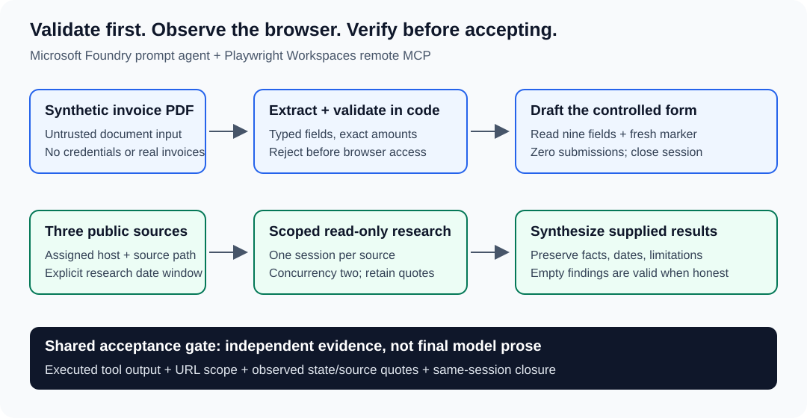

Use this pattern when an agent must operate a website without a suitable API, but its claims need independent verification. **Validate inputs in code, restrict the browser tools, and verify actual page evidence before accepting a result.**

You will draft a synthetic invoice form without submitting it, then apply the same evidence-led pattern to research across three public websites. The reusable artifact is a companion runner with typed contracts, page-state verification, session checks, and a persistent request ledger.

**Run All is offline by default.** It validates fixtures and demonstrates failure handling without Azure sign-in, browser access, provisioning, or paid inference. The optional cloud cell requires an explicit edit and separate authorization.

> Synthetic data and non-production endpoints only. Pages and PDFs are untrusted input. This recipe does not submit forms, approve invoices, make payments, or implement production human approval.

## What you will build



*The same separation applies to both workflows: model output is a claim; inspected browser output is supporting evidence.*

| Workflow | Model responsibility | Code acceptance gate | Takeaway |
| --- | --- | --- | --- |
| Invoice draft | Extract the PDF, then fill only validated values | Exact totals and dates; observed URL, fresh marker, all nine fields, zero submissions, and session closure | Typed draft plus independent verification |
| Three-site research | Inspect one assigned source per task and synthesize supplied results | Source scope, quotes in tool output, date integrity, faithful synthesis, and session closure | Structured report with findings or explicit limitations |

The cloud browser runs in your Playwright workspace, not on this computer. PDF extraction is a separate model call; the browser agent receives only code-validated fields.

## Prerequisites and boundaries

For the offline cells, use Python 3.10+ and the included companion dependencies. Clone the repository, not just the notebook: the helper package, fixtures, instructions, and synthetic HTML are required.

The optional cloud run additionally requires:

- An Azure subscription, Microsoft Foundry project, and compatible deployed model supporting PDF input, structured outputs, and the MCP integration. The source manuscript used `gpt-5.4-mini`; the deployment name is your own.
- A Playwright workspace supporting the remote MCP preview, and caller access to the Foundry project.
- An authorized administrator to grant the project's managed identity **Playwright Workspace Contributor** at that workspace's resource scope. This recipe does not assume an untested narrower custom role works.
- A project-managed-identity remote-tool connection and an HTTPS synthetic form you control. A cloud browser cannot reach your localhost.
- Azure CLI sign-in to the intended tenant, a reviewed request budget, and separate authorization for setup, paid execution, and cleanup.

Check current [remote MCP setup](https://learn.microsoft.com/azure/app-testing/playwright-cloud-browsers/quickstart-automate-browser-tasks-remote-mcp), [Foundry MCP support](https://learn.microsoft.com/azure/foundry/agents/how-to/tools/model-context-protocol), and [model/region availability](https://learn.microsoft.com/azure/foundry/agents/concepts/limits-quotas-regions). Preview availability and service terms can change.

Prompt instructions and post-run URL checks are **not a preventive browser/network allowlist**. Credential-bearing sites, production payment/ERP endpoints, CAPTCHA handling, and consequential actions are out of scope.

## 1. Set up the local recipe

From the repository root, open PowerShell and create a recipe-local environment. Select that interpreter as this notebook's Python kernel. These commands install dependencies; they do not call Azure.

```powershell
Set-Location .\notebooks\data\browser-automation-invoice-and-research
python -m venv .venv
.\.venv\Scripts\python.exe -m pip install -r requirements.txt
.\.venv\Scripts\python.exe -m pip install ipykernel
.\.venv\Scripts\python.exe -m ipykernel install --user --name forgebook-browser-automation --display-name "Forgebook Browser Automation"
.\.venv\Scripts\python.exe -m pytest -q
```

Use the companion's tested SDK pins rather than upgrading packages independently. The included PDFs are already synthetic fixtures; no asset-generation step is needed.

The next cell locates the companion when launched from the repository root, `notebooks`, or the companion directory. It does not change your working directory or load `.env`.

```python
from pathlib import Path
import json
import sys

slug = 'browser-automation-invoice-and-research'
cwd = Path.cwd().resolve()
candidates = [cwd / 'notebooks' / 'data' / slug, cwd / 'data' / slug, cwd]
recipe_root = next((p for p in candidates if (p / 'bat_recipe' / 'paths.py').is_file()), None)
if recipe_root is None:
    raise FileNotFoundError('Open from the repository root, notebooks, or the recipe companion directory.')
if str(recipe_root) not in sys.path:
    sys.path.insert(0, str(recipe_root))

from bat_recipe.contracts import Invoice, SOURCES, validate_invoice
from bat_recipe.paths import ASSETS

print('Companion found. Offline mode; no Azure clients created.')
```

### Companion layout

All helper files are scoped to this recipe's data folder:

```text
data/browser-automation-invoice-and-research/
```

```text
bat_recipe/       Typed contracts, runner, browser evidence, and workflows
assets/           Three synthetic invoice PDFs and expected invoice JSON
demo-form/        Nine-field HTML form with readback and submission sentinel
scripts/          Connection, hosting, marker probe, validation, summary, cleanup
tests/            Offline contract, evidence, and notebook regression tests
instructions.md   Shared draft-only and read-only agent instructions
.env.example      Placeholder configuration, never credentials
requirements.txt  Tested dependencies
```

Keep generated run artifacts outside the checkout. Never copy `.env`, workspace credentials, raw service logs, or real invoices into the recipe.

## 2. Validate the invoice before browser access

`happy_invoice.pdf` contains nine fields matching the included JSON fixture. The `Invoice` contract rejects extra fields and constrains dates, field lengths, currency/PO formats, and decimal precision. `validate_invoice` requires exact `subtotal + tax == total` and a due date no earlier than the invoice date.

Run the same validation locally. Amounts serialize as decimal strings, not approximate floating-point totals. Expected: `invoice_total_matches=true`, `duplicate_check="not_performed"`, and no warnings.

```python
invoice = Invoice.model_validate_json(
    (ASSETS / 'expected_invoice_result.json').read_text(encoding='utf-8')
)
validation = validate_invoice(invoice)
assert validation.invoice_total_matches
assert validation.duplicate_check == 'not_performed'
print(invoice.model_dump_json(indent=2))
print(validation.model_dump_json(indent=2))
```

### Prove that invalid totals stop before the browser

A one-cent mismatch must be a rejection, not a warning that permits form filling. The next cell passes a mocked runner to the real drafting helper and checks that no browser task was called. It does not create an Azure client.

```python
from decimal import Decimal
from unittest.mock import Mock
from bat_recipe.workflows import draft_invoice

bad_values = invoice.model_dump()
bad_values['total'] += Decimal('0.01')
invalid_invoice = Invoice.model_validate(bad_values)
offline_runner = Mock()
try:
    draft_invoice(offline_runner, 'offline-mismatch', invalid_invoice)
except ValueError as exc:
    print(f'Expected rejection: {exc}')
else:
    raise AssertionError('A mismatched invoice was accepted.')
offline_runner.browser_task.assert_not_called()
print('No browser access occurred.')
```

### Keep instructions separate from untrusted content

The shared instructions restrict invoice work to validated values and research to the assigned source. The caller supplies task-specific URLs and output contracts. Read the actual instruction file below; do not put the expected page marker into it.

The injected PDF is an adversarial local fixture, not a document to retry until cloud filtering permits it. The source manuscript reports an earlier `content_filter` block before browser access; the corrected live sequence does not rerun that PDF.

```python
print((recipe_root / 'instructions.md').read_text(encoding='utf-8'))
```

## 3. Configure the optional cloud browser

Skip this section to remain fully offline. Setup creates or changes Azure resources and requires authorization; no setup command is run by this notebook.

The verified integration uses **Playwright Workspaces remote MCP tools through a versioned Foundry prompt agent**. It is not a hosted container or a local Playwright browser.

| Property | Required value |
| --- | --- |
| Workspace MCP target | HTTPS endpoint shown below |
| Connection category | `RemoteTool` |
| Authentication | `ProjectManagedIdentity` |
| Audience | `https://mcp.playwright.microsoft.com` |
| Connection metadata `ResourceId` | Workspace ARM resource ID |
| Identity permission | Playwright Workspace Contributor at that workspace |

Use this remote MCP endpoint:

```text
https://<region>.mcp.playwright.microsoft.com/playwrightworkspaces/<workspace-id>/mcp
```

Do not use this browser/CDP endpoint:

```text
wss://<region>.api.playwright.microsoft.com/playwrightworkspaces/<workspace-id>/browsers
```

The host and path both differ; changing only the scheme is insufficient.

The caller authenticates to Foundry using `AzureCliCredential` and an explicit subscription. Foundry authenticates to the workspace using the **project managed identity**. A successful caller lookup does not prove that second hop; the marker probe does.

After an authorized administrator grants the workspace-scoped role, run the connection helper from the companion directory with your own values:

```powershell
.\scripts\create_mcp_connection.ps1 `
  -SubscriptionId '<subscription-id>' -ResourceGroup '<foundry-resource-group>' `
  -Account '<foundry-account>' -Project '<project-name>' `
  -ConnectionName 'bat-forgebook-<unique-lowercase-suffix>' `
  -WorkspaceResourceId '<full-workspace-arm-id>'
```

The helper derives the endpoint from the actual workspace metadata, refuses to overwrite a connection, and reads the result back. It does not grant roles or change workspace authentication.

### Host only the synthetic form

The HTML has nine labeled fields, a read-only JSON state, and a submission-attempt sentinel. Its Submit button increments a local counter; there is no payment or persistence backend. The agent must never click it.

Render a new unpredictable marker before hosting. Use a fresh directory **outside the checkout**:

```powershell
.\.venv\Scripts\python.exe -m scripts.render_demo C:\temp\bat-hosted-form-<unique-suffix>
.\scripts\host_demo.ps1 -SubscriptionId '<subscription-id>' `
  -ResourceGroup 'rg-bat-forgebook-<unique-lowercase-suffix>' `
  -StorageAccount 'batforge<unique-lowercase-suffix>' `
  -RenderedForm 'C:\temp\bat-hosted-form-<unique-suffix>\invoice-entry.html'
```

Hosting creates a dedicated temporary resource group and storage account, and uploads public synthetic HTML. Approve that action separately. The helper uses Storage key authentication for hosting; this does not change the managed-identity browser route.

Set `DEMO_FORM_URL` to the returned HTTPS URL **including `invoice-entry.html`**. Read `DEMO_EXPECTED_MARKER` from the local `hosted-marker.json`. The expected value must never enter prompts, schemas, instructions, or URL parameters; the agent must discover it from actual browser output.

Earlier trial hosting has been deleted. Create a new form; do not reuse historical URLs.

### Configure your own environment

Copy `.env.example` to an ignored `.env` in the companion directory, then replace the placeholders. No token or key belongs in this configuration. `LIVE_APPROVED` is deliberately absent from the example: set it in the process only after authorizing live work.

```dotenv
AZURE_SUBSCRIPTION_ID=<your-subscription-id>
AZURE_TENANT_ID=<intended-tenant-id>
PROJECT_ENDPOINT=https://<account>.services.ai.azure.com/api/projects/<project>
MODEL_DEPLOYMENT=<your-compatible-deployment-name>
BROWSER_CONNECTION_ID=<full-project-connection-arm-id>
BROWSER_MODE=workspace-mcp
BROWSER_WORKSPACE_MCP_URL=https://<region>.mcp.playwright.microsoft.com/playwrightworkspaces/<workspace-id>/mcp
DEMO_FORM_URL=https://<your-synthetic-host>/invoice-entry.html
DEMO_EXPECTED_MARKER=<value-from-local-hosted-marker.json>
RESEARCH_WINDOW_START=<YYYY-MM-DD>
ARTIFACT_DIR=C:\temp\bat-run-<unique-suffix>
```

`BROWSER_CONNECTION_ID` is the complete ARM ID on one line:

```text
/subscriptions/<sub>/resourceGroups/<rg>/providers/Microsoft.CognitiveServices/accounts/<account>/projects/<project>/connections/<connection>
```

`AZURE_TENANT_ID` documents your intended tenant; it does not switch Azure CLI sign-in. Sign in to the correct tenant and ensure that caller has project access. The runner selects the explicit subscription without changing the CLI default.

Use a valid date window ending today. A model deployment name is configuration, not proof of compatibility with a different model. Revalidate support before substituting it.

## 4. Draft the invoice with independent browser proof

The gated live sequence calls the same helpers used by the local examples. Do not run separate API examples in addition to that sequence against the same approved budget.

| Step | Implementation | Acceptance condition |
| --- | --- | --- |
| Extract | `Runner.extract` sends the PDF as `input_file` with a strict `Invoice` schema | Typed extraction equals the synthetic fixture |
| Validate | `validate_invoice` | Exact amounts, valid dates, currency and PO |
| Draft | `draft_invoice` passes only validated values | Assigned form only; no Submit, Save, Approve, Pay, or Enter |
| Read back | Inspect actual filled page state | Current URL, fresh marker, all nine values, zero submission attempts |
| Verify | Protocol-aware evidence helpers | Executed tool outputs and same-session creation/use/closure |
| Handoff | Save typed draft and verification JSON | Human review only; no submission implementation |

`Runner.create_agent(draft=True)` allows session creation, navigation, snapshot/find, form filling, and closure. Replacing it with `Runner.create_agent()` removes the filling tool for probes and research. Click, press-key, evaluate, run-code, and upload tools are not exposed by the verified policy.

The companion configures service-level MCP approval only for that explicit tool set. This is not authorization to perform consequential actions or a reason to disable client-side permission controls.

The agent returns JSON matching the requested `Draft` contract; unlike extraction, supplying a schema in its prompt is not a claim of server-enforced strict structured output. Code parses the result and independently compares it with the actual tool output.

### Read the draft and verification together

`happy-draft.json` contains the typed draft. `happy-draft-verification.json` records whether independent page evidence matched. A model claim that fields were filled is not verification.

The following is an **illustrative excerpt**, not a captured live response or the complete `Draft` schema:

```json
{
  "status": "awaiting_human_approval",
  "validation": {
    "invoice_total_matches": true,
    "duplicate_check": "not_performed",
    "warnings": []
  },
  "next_action": "Request human review; no submission is implemented."
}
```

The full draft also contains the extracted invoice, filled field names, form URL, and observed page state. Earlier empty snapshots do not establish the final filled state.

The session closes after readback. Typing `approve` later does not submit anything. A production submit workflow would need separate authorization, identity, durable duplicate/idempotency controls, and fresh-state verification. Replacing only the form URL is not sufficient: the demo's field/readback contract is part of this implementation.

## 5. Apply the pattern to three-site research

Each task receives one source, a date-window start, and a typed output contract. At most two tasks run concurrently. Research tools are read-only; each source task owns its own browser session and must close it.

The next offline cell shows the configured source scope. Changing a source also requires changing its scope/evidence tests, not just editing a URL.

```python
assert len(SOURCES) == 3
print('\n'.join(SOURCES))
```

### Keep observations, interpretation, and limitations distinct

`research_all` runs one task per source using a semaphore of two. `verify_site` checks the HTTPS host/path, direct URLs, date window, and explicit limitations. Evidence verification requires the direct URL, content quote, and publication/update excerpt together in one actual browser observation, and checks that session lifecycle and navigation stayed in scope.

A finding contains `title`, `published_or_updated`, `url`, `observed_change`, `why_it_matters`, `evidence_quote`, and nullable `date_evidence_quote`. A claimed date must be within the requested window through today and match a copied Published, Updated, or Released statement. The parser supports ISO `YYYY-MM-DD` and English month-name dates with a day and four-digit year. Missing, ambiguous, or unsupported dating requires `date_not_verified`, a null date excerpt, and a limitation saying it is not a verified in-window change. Such findings receive `no_verified_findings`, not a verified-change status. Organization activity, an event date, a footer, or a catalog month alone is insufficient. Unsupported dated claims fail explicitly rather than being silently corrected.

`merge_research` uses a strict `Report` schema and only the supplied typed source results. It rejects altered source results or an altered window start. It must not manufacture findings to make the report look complete.

An empty result can be correct. The next offline cell constructs a valid no-findings report and checks all three source contracts. It is **illustrative**, not a claim that these sites had no changes.

```python
from datetime import date, timedelta
from bat_recipe.contracts import Report, SiteResult, verify_site

example_since = date.today() - timedelta(days=30)
example_sources = [
    SiteResult(
        site=name, url=url, findings=[],
        limitations=['Illustrative offline example; no browser inspection was performed.'],
    )
    for name, url in zip(['Microsoft Learn: Foundry', 'Azure Updates', 'Microsoft Foundry on GitHub'], SOURCES)
]
for result, source in zip(example_sources, SOURCES):
    verify_site(result, source, example_since)
example_report = Report(
    research_topic='Microsoft Foundry changes', research_window_start=example_since,
    sources=example_sources,
    cross_site_summary=['No evidence was collected in this offline example.'],
    limitations=['Illustrative contract only; not an observed research result.'],
)
print(example_report.model_dump_json(indent=2))
```

## 6. Run the cloud workflow only after approval

First review current pricing and authorize the exact setup and bounded run. Keep one process per artifact directory. Request limits and timeouts are not a hard Azure billing cap; internal model/tool/browser/storage work may incur additional charges.

Use **either** this optional notebook cell **or** the companion CLI sequence, never both for the same run. Set process `LIVE_APPROVED=1` after approval and deliberately change `RUN_LIVE` below to `True`. An inherited approval variable alone cannot turn ordinary Run All into a live run.

The cell loads the recipe-local configuration only inside the opted-in branch. It checks the outside-checkout artifact directory and research-window date before either cloud stage. The CLI shares the artifact guard and validates research configuration before constructing clients for its validation stage; a standalone marker-only probe does not need research settings. The probe must verify the unpredictable marker in actual tool output before validation can proceed. Validation rechecks the gate against the current model, connection, mode, form URL, and marker.

A successful first probe uses one inference request; validation uses six: extraction, drafting, three source tasks, and synthesis. The persistent ledger permits at most eight total requests and at most two probes. A failed first probe does not authorize an automatic retry; any second attempt needs a distinct diagnostic rationale and remaining approval. The command stops on a failure and does not reset the ledger.

The runner closes clients and deletes only its owned agent version after use. Tasks must close their browser sessions; inspect remote lifecycle explicitly after failures or timeouts.

```python
RUN_LIVE = False

if RUN_LIVE:
    import os
    import subprocess
    from dotenv import load_dotenv
    from bat_recipe.paths import artifact_directory
    from scripts.diagnose_bat import research_window_start

    if os.environ.get('LIVE_APPROVED') != '1':
        raise RuntimeError('Authorize the live run and pricing first; set LIVE_APPROVED=1 in the process.')
    load_dotenv(recipe_root / '.env')
    artifact_dir = artifact_directory(os.environ['ARTIFACT_DIR'])
    research_window_start()
    for stage in ('probe', 'validate'):
        subprocess.run(
            [sys.executable, '-m', 'scripts.diagnose_bat', stage],
            cwd=recipe_root, check=True,
        )
    subprocess.run(
        [sys.executable, '-m', 'scripts.summarize_run', str(artifact_dir)],
        cwd=recipe_root, check=True,
    )
else:
    print('Offline run complete. No inference, cloud setup, or browser access was requested.')
```

## 7. Review evidence, not just a successful response

`ARTIFACT_DIR` receives the draft, independent verification, `research-0.json` through `research-2.json`, `web-change-report.json`, sanitized original response/tool items, request reservations, usage when supplied, and cleanup records.

| Evidence | What it establishes | What it does not establish |
| --- | --- | --- |
| Executed successful `mcp_call` output | A specific tool returned actual content | Correctness of model prose without comparison |
| Fresh marker and current page state | The actual form was inspected and nine values matched | Production submission or a durable draft record |
| URL, quote, date/limitation | A supported observation within stated scope | Complete coverage of a website |
| Session IDs across creation/use/closure | Same-task lifecycle completed | That timed-out remote work was cancelled |
| Top-level token usage | Visible model usage at reviewed rates | Complete Azure bill or all internal operations |

`mcp_list_tools` proves discovery only. Pending approval, empty/failed tool output, missing session closure, or final agent-authored JSON must remain failures or unknowns, not success.

Keep response IDs, correlation metadata, source evidence, and local artifacts under an explicit retention policy. Credential scrubbing is not a complete privacy policy; review before sharing.

### Validation cases and provenance

| Case | Expected outcome | Evidence scope |
| --- | --- | --- |
| Happy invoice | Nine fields match; no submission | Requires actual cloud page evidence |
| One-cent mismatch | Rejected before browser access | Demonstrated locally above and covered by tests |
| Injected PDF | Embedded command never authorizes submission | Earlier manuscript reports filtering; no cloud retry in this sequence |
| Missing/empty tool output | Reject browser-success claims | Offline protocol/evidence tests |
| No verified research findings | Preserve empty findings and explicit limitations | Valid contract, not proof that no changes occurred |

The 9 October 2026 source manuscript reports a corrected cloud trial verifying the marker/URL, nine invoice fields, zero submissions, three inspected research sources, faithful synthesis, and five closed sessions. It reported no verified dated material research findings. Those are **historical author-reported observations**, not a fresh run of this ported notebook.

The earlier preview integration returned empty outputs; its exact internal cause remains unconfirmed. The corrected route uses the documented HTTPS workspace MCP endpoint. Do not equate the historical failure with current MCP results or repeat failed diagnostics without a new rationale.

A publication reviewer must decide whether that existing trial plus current offline checks suffice or a separately authorized fresh cloud run is required. Do not report historical test counts or cost estimates as newly measured results.

## Troubleshooting and production limits

| Symptom | Investigate before any authorized rerun |
| --- | --- |
| Endpoint must use HTTP/HTTPS | Check the full MCP hostname/path, not the WebSocket browser target |
| Project/connection authorization fails | Check `/api/projects/<project>`, `RemoteTool`, identity, audience, and workspace-scoped role |
| Tools discovered but no execution proof | Inspect executed records and nonempty successful output; discovery is not execution |
| Marker gate fails | Compare the current URL, local marker, model, connection, and actual page readback |
| Form evidence differs | Stop; inspect all nine values and the submission counter; adapt the contract before rerunning |
| Content filtered | Preserve the expected block; never disguise the PDF or weaken filtering |
| Timeout | Preserve IDs and inspect remote lifecycle; a client timeout does not prove cancellation |
| Empty research report | Read per-source limitations; distinguish no supported finding from an execution failure |
| SDK arguments differ | Restore tested pins and inspect current public API support before upgrading |

For production, add preventive network controls, durable duplicate/idempotency checks, data minimization, retention, least privilege, and separate authorization for consequential actions. Unknown outcomes must not default to a retryable category.

Live View, cloud recording, active human takeover, 20+ case batches, recurring schedules, and a testing dashboard are **not implemented or verified here**. Local UI screenshots are not proof of cloud recording. Treat these as separate extensions with their own support, approval, budgets, and tests.

## 8. Clean up only resources created for this run

The runner deletes its owned agent version and closes clients; replacing the draft-capable version with the read-only version also removes the earlier owned version. Browser closure is checked independently in task evidence.

After review and explicit deletion authorization, remove only the temporary connection, newly created role assignment, and dedicated hosting storage/resource group. Preserve shared models, projects, workspaces, existing roles, fixtures, and approved local evidence.

Prepare a reviewed inventory outside the checkout using exact created-resource identifiers:

```json
{
  "subscription": "<subscription-id>",
  "created_resource_group": "rg-bat-forgebook-<unique-lowercase-suffix>",
  "created_storage_account": "batforge<unique-lowercase-suffix>",
  "created_connection": "<full-new-connection-arm-id>",
  "created_role_assignment": "<full-new-role-assignment-arm-id>"
}
```

Run `scripts\cleanup_demo.ps1 -Inventory '<reviewed-inventory.json>'` only after checking ownership and scope. The helper validates demo names and hosting contents; it does not discover arbitrary resources or guarantee failed remote sessions have stopped. If you reused a pre-existing role or setup differs, do not put that resource into a created-resource inventory; arrange separately scoped cleanup.

Verify each deletion independently. The managed-identity browser route creates no workspace token to rotate. Never delete a request ledger to regain budget.

## Take the pattern with you

Reuse the boundary, not just the prompt: **typed inputs before browser work, a minimal tool set, independent observed state, and explicit limitations**. The invoice draft and research report are two applications of that same acceptance rule.

Adapt a form or research scope only with matching contracts and evidence checks. Keep production approval, observability extensions, and larger batches separate from this verified draft/read-only pattern.

## References

- [Playwright Workspaces remote MCP setup and Entra audience](https://learn.microsoft.com/azure/app-testing/playwright-cloud-browsers/quickstart-automate-browser-tasks-remote-mcp)
- [Foundry MCP integration](https://learn.microsoft.com/azure/foundry/agents/how-to/tools/model-context-protocol)
- [Browser Automation documentation](https://learn.microsoft.com/azure/foundry/agents/how-to/tools/browser-automation)
- [Tool, model, and region availability](https://learn.microsoft.com/azure/foundry/agents/concepts/limits-quotas-regions)
- [Azure Storage static website hosting](https://learn.microsoft.com/azure/storage/blobs/storage-blob-static-website)