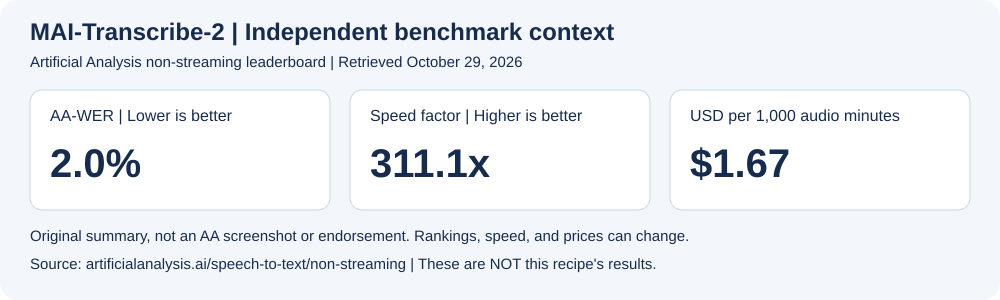
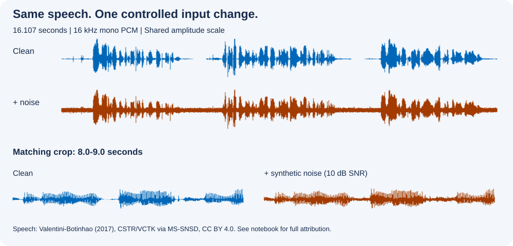

For Python application developers, this recipe teaches a controlled comparison: send the same speech with and without added noise to **MAI-Transcribe-2 (preview)** in Microsoft Foundry. Keep the model and request settings fixed so you can inspect what changed in the transcript. Listen to both inputs before drawing a conclusion.

**By the end, you can:**
- Build a reusable, keyless transcription function.
- Compare paired audio inputs without confusing input changes with model changes.
- Run a small Gradio comparison UI locally from your notebook.

**Scope:** one speaker, file-based transcription, and a synthetic noise condition. No diarization, summarization, noise suppression, or streaming. This is a reproducible example, not a model benchmark.

## Prerequisites

- Python 3.11+ and a running Jupyter kernel. Download the notebook together with its `media/mai-transcribe-2-noisy-audio/` and `data/mai-transcribe-2-noisy-audio/` folders, or clone the recipe repository. Downloading only the notebook omits the audio.
- An existing Azure Speech resource in a [supported MAI region](https://learn.microsoft.com/azure/ai-services/speech-service/regions?tabs=llmspeech). Use its custom-subdomain endpoint, not a Foundry project URL; no model deployment is required.
- Microsoft Entra authentication configured for that Speech resource, including the **Cognitive Services Speech User** role assigned to your identity. Sign in with Azure CLI locally, or use managed identity in Azure. See [Speech Entra authentication](https://learn.microsoft.com/azure/ai-services/speech-service/how-to-configure-azure-ad-auth).
- Sign in with `az login`, then select the subscription containing the resource with `az account set --subscription <subscription-id>`. Confirm the signed-in account and subscription with `az account show`.
- In the Azure portal, open the Speech resource and copy its custom-subdomain endpoint from **Keys and Endpoint**. Under **Access control (IAM) > Role assignments**, confirm your identity has **Cognitive Services Speech User**. Do not create a resource just for this recipe.
- Set **`SPEECH_ENDPOINT`** before starting Jupyter so the kernel inherits it. In PowerShell, run `$env:SPEECH_ENDPOINT = "https://<your-resource>.cognitiveservices.azure.com"` and then `jupyter lab` in the same window. In bash, use `export SPEECH_ENDPOINT="https://<your-resource>.cognitiveservices.azure.com"` before `jupyter lab`. If Jupyter is already open, restart its kernel after setting the variable in the environment that launched it. No model deployment name or API key is needed. Never commit credentials or `.env` files.

Allow about 10 minutes for setup and exploration; API latency varies. Each comparison makes two billable requests. At the [announced introductory price](https://microsoft.ai/models/mai-transcribe-2/) of $0.10 per audio hour through 2026, estimate cost as `2 * clip_seconds / 3600 * 0.10` USD per comparison. Confirm current pricing before running; repeated UI clicks make new requests.

The published page plays the bundled audio without Azure or Python. Live inference and Gradio require executing this notebook. The comparison below includes a recorded live result from an East US Speech resource on October 29, 2026. It is an observation on this fixture, not a measured accuracy improvement.

### Why measure speed and cost together?

The [Microsoft AI launch article](https://microsoft.ai/news/mai-transcribe-2-is-the-fastest-most-accurate-and-cheapest-speech-recognition-model-in-the-world/) (September 3, 2026) highlights multilingual transcription, noisy audio, and low-cost batch processing. Its competitor speed ratios are launch-time claims, not results from this notebook. The introductory rate is **$0.10 per audio hour through the end of 2026**; billing is based on input duration, not WAV bytes or request latency.



**Independent context, retrieved October 29, 2026:** [Artificial Analysis non-streaming leaderboard](https://artificialanalysis.ai/speech-to-text/non-streaming) lists MAI-Transcribe-2 at **2.0% AA-WER**, **311.1x speed factor**, and **$1.67 per 1,000 minutes**. These are separate benchmark results, not this recipe's measurements. Its [methodology](https://artificialanalysis.ai/methodology/speech-to-text) uses a multi-dataset English accuracy evaluation and median speed measurements with network latency; its speed test uses 10-minute audio. Results for our 16-second clip can differ substantially. The graphic is an original summary of cited facts, not an Artificial Analysis screenshot or endorsement. Rankings and prices can change.

MAI's published capabilities also include 60 languages, diarization, timestamps, and keyword biasing. This recipe exercises only file transcription on one English speaker; it does not validate those other capabilities or the separate Streaming model. The current model page contains a `2.1` benchmark reference; our request remains explicitly `MAI-Transcribe-2`.

## Outline

1. Listen to the paired inputs and inspect their provenance.
2. Configure keyless access and transcribe both clips.
3. Compare the text and run the local miniapp.
4. Close the app and identify the limits of this comparison.

## 1. Install the notebook dependencies

Run this cell once. Gradio is recipe-local, not a factory-wide dependency. Restart the kernel if the package manager requests it. NumPy is needed only if you rebuild the bundled audio with the preparation script.

```python
%pip install "azure-identity>=1.25,<2" "requests>=2.32,<3" "gradio==6.24.0" "numpy>=2,<3"
```

## 2. Listen to the inputs

**When to use:** you need to inspect how noise affects a particular recording.
**What it does:** the second clip contains the exact same speech, with seeded Gaussian white noise added at 10 dB signal-to-noise ratio (SNR).
**How to adapt:** replace the pair with consented recordings from your setting. Keep the speech content and request settings identical across the pair.



The waveform detail uses the same one-second interval and amplitude scale for both clips. It shows the input change, not model accuracy.

### Clean speech

<audio controls preload="none" src="media/mai-transcribe-2-noisy-audio/01-clean-speech.wav">Your browser does not support audio playback.</audio>

[Download clean speech](media/mai-transcribe-2-noisy-audio/01-clean-speech.wav).

### Speech with synthetic noise

<audio controls preload="none" src="media/mai-transcribe-2-noisy-audio/02-noisy-speech.wav">Your browser does not support audio playback.</audio>

[Download noisy speech](media/mai-transcribe-2-noisy-audio/02-noisy-speech.wav).

**Audio attribution:** Cassia Valentini-Botinhao (2017), [Noisy speech database for training speech enhancement algorithms and TTS models, 2016](https://doi.org/10.7488/ds/2117), University of Edinburgh, CSTR, under [CC BY 4.0](https://creativecommons.org/licenses/by/4.0/). Speech obtained through [Microsoft MS-SNSD](https://github.com/microsoft/MS-SNSD/tree/fe61c4ba0d9ac8dd7e23d719cc79f8947e1dc742), `clean_train/p234_004.wav`, `p234_005.wav`, and `p234_006.wav`. Original corpus: Christophe Veaux, Junichi Yamagishi, and Kirsten MacDonald (2017), [CSTR VCTK Corpus](https://doi.org/10.7488/ds/1994), University of Edinburgh.

**Changes:** concatenated three complete utterances with two half-second gaps; applied a shared gain; added synthetic noise only to the noisy version. SNR uses whole-recording RMS, including the gaps, not active-speech level. This is not recorded environmental noise. Both output clips retain CC BY 4.0 terms. No speaker or dataset-author endorsement is implied. See the [audio notice](media/mai-transcribe-2-noisy-audio/LICENSE-AUDIO.txt). The bundled `data/mai-transcribe-2-noisy-audio/audio-provenance.json` records source URLs and file hashes.

MS-SNSD citation: Reddy, Beyrami, Pool, Cutler, Srinivasan, and Gehrke, [A Scalable Noisy Speech Dataset and Online Subjective Test Framework](https://www.isca-speech.org/archive/Interspeech_2019/pdfs/3087.pdf), Interspeech 2019, pp. 1816-1820.

### Check the local files

Run from the repository root or the `notebooks` directory. This cell verifies both files against the provenance manifest and reports duration and the estimated cost per comparison. It makes no Azure calls.

```python
import hashlib
import json
from pathlib import Path
import wave

SLUG = "mai-transcribe-2-noisy-audio"
NOTEBOOK_DIR = Path.cwd() if (Path.cwd() / "media" / SLUG).is_dir() else Path.cwd() / "notebooks"
MEDIA_DIR = NOTEBOOK_DIR / "media" / SLUG
DATA_DIR = NOTEBOOK_DIR / "data" / SLUG
provenance = json.loads((DATA_DIR / "audio-provenance.json").read_text(encoding="utf-8"))
CLEAN_AUDIO = MEDIA_DIR / "01-clean-speech.wav"
NOISY_AUDIO = MEDIA_DIR / "02-noisy-speech.wav"
for audio_path in (CLEAN_AUDIO, NOISY_AUDIO):
    if hashlib.sha256(audio_path.read_bytes()).hexdigest() != provenance["outputs"][audio_path.name]:
        raise ValueError(f"Audio checksum mismatch: {audio_path.name}")
    with wave.open(str(audio_path), "rb") as audio:
        seconds = audio.getnframes() / audio.getframerate()
    print(f"{audio_path.name}: {seconds:.2f} seconds, {audio_path.stat().st_size:,} bytes ({audio_path.stat().st_size / 1024:.1f} KiB)")
print(f"Estimated introductory cost per pair: ${2 * seconds / 3600 * 0.10:.5f} USD")
```

Some notebook frontends do not resolve relative HTML media URLs. The next cell displays embedded players in a running notebook without depending on the notebook server's file routes. The static page uses the native players above.

```python
from IPython.display import Audio, Markdown, display

for label, audio_path in (("Clean speech", CLEAN_AUDIO), ("Speech with synthetic noise", NOISY_AUDIO)):
    display(Markdown(f"**{label}**"))
    display(Audio(filename=str(audio_path), embed=True))
```

## 3. Configure keyless transcription

Use `DefaultAzureCredential` so the same function can use your Azure CLI sign-in locally or managed identity in Azure. Validate the resource endpoint before attaching a bearer token. This recipe targets public Azure custom-subdomain endpoints.

The [documented minimal request](https://learn.microsoft.com/azure/ai-services/speech-service/mai-transcribe) explicitly selects `MAI-Transcribe-2` and enables enhanced mode. Keep automatic language detection and default verbatim output. Do not retry with the model field removed: that could silently switch models.

```python
import os
import re
from urllib.parse import urlsplit

from azure.identity import DefaultAzureCredential
import requests

def validate_endpoint(value: str) -> str:
    parsed = urlsplit(value)
    if (
        parsed.scheme != "https"
        or not re.fullmatch(r"[a-z0-9][a-z0-9-]*\.cognitiveservices\.azure\.com", parsed.hostname or "")
        or parsed.netloc != parsed.hostname
        or parsed.path not in ("", "/")
        or parsed.query or parsed.fragment
    ):
        raise ValueError("Set SPEECH_ENDPOINT to https://<resource>.cognitiveservices.azure.com")
    return value.rstrip("/")

ENDPOINT = validate_endpoint(os.environ.get("SPEECH_ENDPOINT", ""))
credential = DefaultAzureCredential()
DEFINITION = {"enhancedMode": {"enabled": True, "model": "MAI-Transcribe-2"}}
API_VERSION = "2025-10-15"
print(f"Configured {DEFINITION['enhancedMode']['model']}; no request sent yet.")
```

### Define one reusable transcription function

Send a WAV file and the JSON definition as multipart form data. Let `requests` set the multipart boundary. Acquire the token for each call so a long-running notebook can refresh credentials. The function returns the transcript and the original JSON for inspection. Network, authorization, HTTP, and unexpected-response errors stop the call rather than returning a fake transcript.

```python
def transcribe(audio_path: Path) -> tuple[str, dict]:
    token = credential.get_token("https://cognitiveservices.azure.com/.default").token
    with audio_path.open("rb") as audio:
        response = requests.post(
            f"{ENDPOINT}/speechtotext/transcriptions:transcribe",
            params={"api-version": API_VERSION},
            headers={"Authorization": f"Bearer {token}"},
            files={"audio": (audio_path.name, audio, "audio/wav")},
            data={"definition": json.dumps(DEFINITION)},
            timeout=(10, 180),
            allow_redirects=False,
        )
    if 300 <= response.status_code < 400:
        raise RuntimeError("Unexpected redirect; check the Speech resource endpoint.")
    response.raise_for_status()
    result = response.json()
    phrases = result.get("combinedPhrases") if isinstance(result, dict) else None
    if not isinstance(phrases, list) or not all(
        isinstance(phrase, dict) and isinstance(phrase.get("text"), str)
        for phrase in phrases
    ):
        raise ValueError("Unexpected response: expected combinedPhrases with text fields.")
    text = "\n".join(phrase["text"] for phrase in phrases).strip()
    if not text:
        raise ValueError("The service returned no recognized speech. Listen to the input and inspect the response.")
    return text, result
```

### Measure the cost and elapsed time of each call

Time the whole transcription function with a monotonic clock: credential acquisition, file upload, network round trip, service processing, and JSON parsing. This is **client-observed wall time**, not isolated model inference time. The first call can include cold authentication overhead. Speed factor is audio seconds divided by elapsed seconds; real-time factor (RTF) is its inverse. Neither is streaming latency.

Cost is an estimate from input duration at the stated introductory rate, not an Azure invoice. It excludes billing rounding, minimums, taxes, and other services. Update the rate after 2026 or when pricing changes. The same metrics appear in the local UI and saved comparison.

```python
from time import perf_counter

PRICE_USD_PER_AUDIO_HOUR = 0.10  # Introductory rate through December 2026.

def transcribe_measured(audio_path: Path) -> tuple[str, dict, dict]:
    with wave.open(str(audio_path), "rb") as audio:
        duration = audio.getnframes() / audio.getframerate()
    started = perf_counter()
    text, result = transcribe(audio_path)
    elapsed = perf_counter() - started
    metrics = {
        "file": audio_path.name,
        "size_bytes": audio_path.stat().st_size,
        "audio_seconds": duration,
        "client_elapsed_seconds": elapsed,
        "speed_factor": duration / elapsed,
        "real_time_factor": elapsed / duration,
        "estimated_cost_usd": duration / 3600 * PRICE_USD_PER_AUDIO_HOUR,
        "price_usd_per_audio_hour": PRICE_USD_PER_AUDIO_HOUR,
    }
    return text, result, metrics

def metrics_table(*rows: dict) -> str:
    table = "| Input | Bytes | Audio (s) | Client time (s) | Speed factor | RTF | Est. USD |\n"
    table += "|---|---:|---:|---:|---:|---:|---:|\n"
    for row in rows:
        table += (
            f"| {row['file']} | {row['size_bytes']:,} | {row['audio_seconds']:.3f} | "
            f"{row['client_elapsed_seconds']:.3f} | {row['speed_factor']:.2f}x | "
            f"{row['real_time_factor']:.3f} | ${row['estimated_cost_usd']:.7f} |\n"
        )
    return table
```

## 4. Transcribe the pair and compare

**This cell sends two billable requests to Azure.** Both calls use the same definition. If the second fails, the first is still billable; no automatic retry is made. Read the actual outputs below instead of expecting noise to reduce accuracy. Equal transcripts are a valid result on this clip.

```python
clean_text, clean_result, clean_metrics = transcribe_measured(CLEAN_AUDIO)
noisy_text, noisy_result, noisy_metrics = transcribe_measured(NOISY_AUDIO)
print("CLEAN TRANSCRIPT\n" + clean_text)
print("\nNOISY TRANSCRIPT\n" + noisy_text)
print(f"\nExact transcript match: {clean_text == noisy_text}")
print("\n" + metrics_table(clean_metrics, noisy_metrics))
print(f"Estimated pair cost: ${clean_metrics['estimated_cost_usd'] + noisy_metrics['estimated_cost_usd']:.7f} USD")
```

### Recorded speed and cost for this pair

Live run on October 29, 2026, East US; one sequential request per clip, using the explicit model definition above:

| Input | File size | Audio duration | Client wall time | Speed factor | Estimated USD |
|---|---:|---:|---:|---:|---:|
| Clean | 515,454 bytes (503.4 KiB) | 16.107 s | 3.398 s | 4.74x | $0.0004474 |
| Synthetic noise, 10 dB SNR | 515,454 bytes (503.4 KiB) | 16.107 s | 1.919 s | 8.39x | $0.0004474 |

**Pair total:** 32.213 audio seconds, 1,030,908 audio-file bytes (excluding multipart overhead), estimated **$0.0008948** at $0.10/audio hour. These numbers do not include any billing rounding or minimums. Both transcripts matched.

The first call included cold credential acquisition, so the shorter second call does **not** show that noisy audio is intrinsically faster. There was no warm-up or repeated-trial median. Rerunning the cell or UI displays fresh measurements; this table preserves the recorded observation. Raw responses, exact timings, pricing assumption, audio hashes, and timestamp are bundled in `data/mai-transcribe-2-noisy-audio/live-comparison.json`. Do not extrapolate this short-clip run to the MAI blog's one-hour example or the AA ten-minute speed test.

**Recorded live observation (October 29, 2026, East US):** both requests succeeded with the explicit `MAI-Transcribe-2` definition above and returned identical transcript text. No model fallback was used. This shows that the added 10 dB synthetic noise did not change the returned text on this pair; it does not establish accuracy against an independent reference.

Listen again and check omissions, added words, and punctuation. Exact text equality is descriptive, not an accuracy score. The clean model output is **not ground truth**. To report word error rate, first obtain or manually verify an independent reference and document text normalization. Neither this single speaker nor synthetic white noise represents meetings, accents, or real environmental noise.

### Save the comparison artifact

Save both raw responses with the request definition and audio hashes. The artifact contains no access token. It is written under the system temporary directory, outside the recipe repository; do not commit private transcripts. Each run creates a new directory.

```python
from datetime import datetime, timezone
import tempfile

artifact_path = Path(tempfile.mkdtemp(prefix="mai-transcribe-2-")) / "comparison.json"
artifact = {
    "created_at": datetime.now(timezone.utc).isoformat(),
    "api_version": API_VERSION,
    "definition": DEFINITION,
    "audio_sha256": provenance["outputs"],
    "clean_response": clean_result,
    "noisy_response": noisy_result,
    "metrics": [clean_metrics, noisy_metrics],
    "timing_scope": "client wall time including authentication, upload, network, service, and parsing",
}
artifact_path.write_text(json.dumps(artifact, indent=2, ensure_ascii=False), encoding="utf-8")
print(f"Saved comparison: {artifact_path}")
```

## 5. Run the local Gradio miniapp

The UI reuses `transcribe` and the verified fixed fixtures. There are no uploads, microphone capture, or credential fields. Launching the UI makes no inference requests; **Transcribe both** makes two new billable calls. Results appear together only after both calls succeed. Errors are shown explicitly; earlier successful requests remain billable.

Gradio runs a Python server on loopback and displays it inline in the running notebook. `share=False` prevents a public share tunnel. Keep forwarded ports private in Codespaces or remote Jupyter; if loopback cannot be displayed inline, use your notebook environment's private port forwarding. The static Forgebook page cannot execute this cell and instead uses the native players above.

```python
import gradio as gr

def transcribe_pair() -> tuple[str, str, str, str]:
    clean, _, clean_stats = transcribe_measured(CLEAN_AUDIO)
    noisy, _, noisy_stats = transcribe_measured(NOISY_AUDIO)
    return clean, noisy, f"Completed two requests. Exact transcript match: {clean == noisy}. Not an accuracy score.", metrics_table(clean_stats, noisy_stats)

with gr.Blocks(title="MAI-Transcribe-2: clean vs noisy", analytics_enabled=False) as demo:
    gr.Markdown("## Listen, transcribe, compare\nSame speech; synthetic white noise at 10 dB SNR. No noise suppression is applied.")
    with gr.Row():
        with gr.Column():
            gr.Audio(value=str(CLEAN_AUDIO.resolve()), label="Clean speech", interactive=False)
            clean_output = gr.Textbox(label="Clean transcript", lines=6, interactive=False)
        with gr.Column():
            gr.Audio(value=str(NOISY_AUDIO.resolve()), label="Speech with synthetic noise", interactive=False)
            noisy_output = gr.Textbox(label="Noisy transcript", lines=6, interactive=False)
    status = gr.Textbox(label="Run status", value="No requests sent by this UI yet. Each click sends two billable requests.", interactive=False)
    metrics_output = gr.Markdown("Metrics appear after a successful pair. Estimated cost uses $0.10/audio hour through 2026; client time includes authentication and network overhead.")
    run = gr.Button("Transcribe both (2 billable requests)", variant="primary")
    run.click(
        fn=transcribe_pair, outputs=[clean_output, noisy_output, status, metrics_output],
        concurrency_limit=1, api_visibility="private",
    ).failure(
        fn=lambda: ("", "", "Comparison failed. See the error notification. A completed request may still be billed.", "No complete metrics for this pair."),
        outputs=[clean_output, noisy_output, status, metrics_output], api_visibility="private",
    )
    gr.Markdown(
        "Audio: Cassia Valentini-Botinhao (2017), University of Edinburgh/CSTR, "
        "[source](https://doi.org/10.7488/ds/2117), [CC BY 4.0](https://creativecommons.org/licenses/by/4.0/), "
        "via [Microsoft MS-SNSD](https://github.com/microsoft/MS-SNSD). "
        "Original [CSTR VCTK corpus](https://doi.org/10.7488/ds/1994): Christophe Veaux, Junichi Yamagishi, and Kirsten MacDonald (2017). "
        "Three utterances concatenated; shared gain; synthetic noise added to the second clip. No endorsement implied."
    )

demo.launch(server_name="127.0.0.1", share=False, inline=True, show_error=True, prevent_thread_lock=True)
```

## Pitfalls and recovery

| Symptom | Likely cause | Action |
|---|---|---|
| Missing audio or manifest | Only the notebook was downloaded, or the working directory is wrong | Keep the media/data folders and run from the root or `notebooks`. |
| `SPEECH_ENDPOINT` validation error | A project, regional, or malformed URL was supplied | Use the resource's public Azure custom-subdomain endpoint. |
| Credential error, HTTP 401 or 403 | Wrong sign-in, scope, or missing Speech data-plane role | Confirm the intended Azure identity, token scope, custom subdomain, and Speech User role. Do not fall back to a key. |
| HTTP 400 or 404 | Wrong region, unsupported model, or preview contract change | Check current model docs and the resource region. Do not remove `model` or `enhancedMode` to force success. |
| HTTP 429 or timeout | Quota, throttling, or service delay | Wait and inspect the failure before manually retrying; a timed-out request might still be billed. |
| Gradio is blank in remote Jupyter | The browser cannot reach kernel loopback | Use private port forwarding. Do not set `share=True` just to bypass network configuration. |
| Transcripts match | This noise condition did not alter the returned text | Report that observation; do not invent an accuracy improvement. |

### Exercise

Generate a separate 5 dB experiment without overwriting the bundled 10 dB pair or its provenance manifest. Run this cell from the repository root or `notebooks`; it writes the experiment to a unique temporary directory and prints that path:

```python
import subprocess
import sys
import tempfile

experiment_dir = Path(tempfile.mkdtemp(prefix="mai-transcribe-snr-5-"))
subprocess.run([
    sys.executable,
    str(DATA_DIR / "prepare_audio.py"),
    "--snr-db", "5",
    "--output-dir", str(experiment_dir),
], check=True)
print(f"Experimental pair saved to {experiment_dir}")
```

The script downloads only the three pinned source utterances, generates noise with seed 42, applies a common gain to prevent clipping, and writes a matching manifest beside the experimental audio. Listen to the new files from that directory; the notebook's canonical comparison continues to use the bundled 10 dB pair. Full-recording SNR includes silence, not just active speech.

For a real evaluation, use consented domain recordings and a verified reference transcript. Add more speakers and realistic noise conditions before generalizing. Caption alignment, diarization, and summarization belong in separate recipes.

## What you built

You built a reusable `transcribe` function with keyless Azure authentication, compared controlled inputs with a fixed model definition, and launched a local Gradio UI from a notebook. The saved JSON comparison ties raw service outputs to the exact audio hashes and request settings. These are inspection artifacts, not proof of broad noise robustness.

## Cleanup

After using the UI, run the next cell to stop its local server and close the credential. Rerun the configuration cell before making new calls. Remove the printed comparison directory manually when you no longer need it. This recipe does not create Azure resources.

```python
demo.close()
credential.close()
print("Local Gradio server and credential closed.")
```