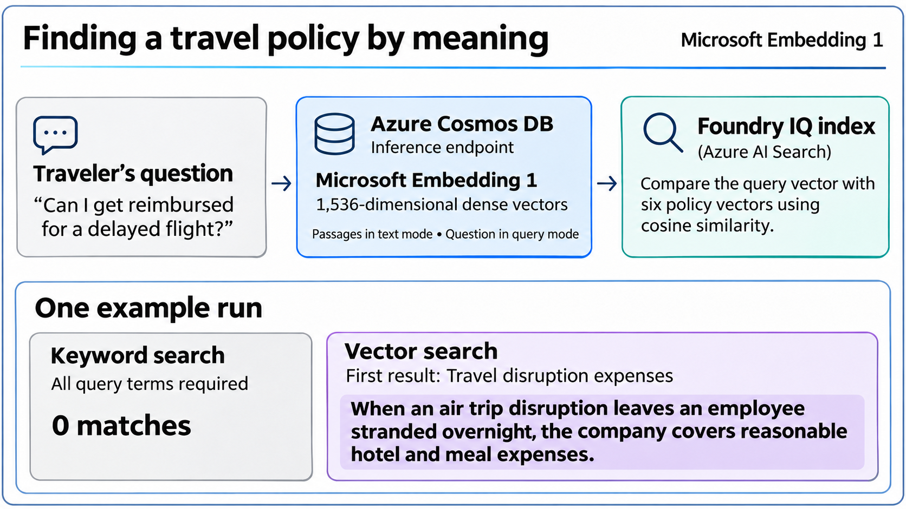

**Use Microsoft Embedding 1 with Foundry IQ (Azure AI Search)**



When keyword search misses a differently worded question, use Microsoft Embedding 1 (preview) to find relevant passages by meaning. This recipe generates document and query vectors through an **Azure Cosmos DB inference endpoint**, then compares keyword and vector retrieval over fictional company policies in a [Foundry IQ (Azure AI Search)](https://learn.microsoft.com/azure/search/search-what-is-azure-search) index. The inference endpoint and the Search service are separate resources. The recipe uses direct index and query APIs, not a Foundry IQ knowledge base or agentic retrieval.

**When to use:** Your application supplies embeddings to a search index and needs to retrieve text that may not share the query's wording.

**What it does:** Microsoft Embedding 1 supports configurable dimensions and separate `text` and `query` modes. The application stores passage vectors and searches with a query vector using cosine similarity.

**How to adapt:** Compare retrieval quality, latency, and cost against your existing model on labeled examples before choosing a model or dimension.

## Prerequisites and cost

- Python 3.10 or later and the Azure CLI; allow about 10 minutes after the Azure resources and permissions are ready.
- An Azure Cosmos DB account with an [inference endpoint enabled](https://learn.microsoft.com/azure/cosmos-db/gen-ai/generate-embedding). Use its inference endpoint, not its data endpoint. Microsoft Embedding 1 is **preview** and available through this endpoint in the [listed regions](https://learn.microsoft.com/azure/cosmos-db/gen-ai/microsoft-embedding-1#model-specifications).
- A Foundry IQ (Azure AI Search) service that supports vector indexes. Enable role-based access on the service. The calling identity needs **Embedding User** on the inference account and **Search Service Contributor** plus **Search Index Data Contributor** on the Search service. Ask an administrator to configure access; this notebook does not change roles.
- Sign in with `az login` and select the authorized CLI account. This notebook uses `AzureCliCredential`, so another credential in the environment does not take precedence. For an Azure-hosted application, replace it with an explicitly configured `ManagedIdentityCredential` and grant that identity the same roles. See [credential selection](https://learn.microsoft.com/azure/developer/python/sdk/authentication/credential-chains).
- Set `EMBEDDING_ENDPOINT` to the inference endpoint and `AZURE_SEARCH_ENDPOINT` to the Search service endpoint in the environment **before starting the kernel**. No keys are embedded in the notebook. Production applications can obtain any required secrets from a managed store such as Azure Key Vault.
- Install the dependencies in the notebook's Python environment:

  ```text
  python -m pip install "azure-data-ai==1.1.0b1" "azure-search-documents==12.0.0" "azure-identity>=1.25,<2"
  ```

The six passages and one query make **seven embedding requests**, plus Search operations. Check current [model pricing](https://learn.microsoft.com/azure/cosmos-db/gen-ai/microsoft-embedding-1#pricing) and [Search pricing](https://azure.microsoft.com/pricing/details/search/) for your region and tier. Search charges can continue while a paid service exists. The notebook deletes its temporary **index**, not either service.

The policy passages below are fictional and require no external files.

```python
import math
import os
import time
import uuid

from azure.core import MatchConditions
from azure.core.exceptions import AzureError
from azure.data.ai import InferenceClient
from azure.identity import AzureCliCredential
from azure.search.documents import SearchClient
from azure.search.documents.indexes import SearchIndexClient
from azure.search.documents.indexes.models import (
    HnswAlgorithmConfiguration,
    HnswParameters,
    SearchField,
    SearchFieldDataType,
    SearchIndex,
    SearchableField,
    SimpleField,
    VectorSearch,
    VectorSearchProfile,
)
from azure.search.documents.models import VectorizedQuery

MODEL = "microsoft-embedding-1-large"
DIMENSIONS = 1536
print("SDK imports ready; using 1,536-dimensional dense vectors.")
```

## Choose a small retrieval check

A traveler asks about reimbursement after a delayed flight. The relevant policy describes an air-travel disruption in different words. Compare the keyword results with the vector query and see where `travel` appears. This is one smoke test, not a relevance benchmark.

```python
documents = [
    {
        "id": "travel",
        "title": "Travel disruption expenses",
        "content": "When an air trip disruption leaves an employee stranded overnight, the company covers reasonable hotel and meal expenses. Submit receipts to the travel team within 30 days.",
    },
    {
        "id": "baggage",
        "title": "Lost baggage",
        "content": "Employees whose checked baggage is lost during business travel may claim essential replacement items with receipts.",
    },
    {
        "id": "booking",
        "title": "Changing a booking",
        "content": "Use the booking portal to change an itinerary when a business meeting moves. A manager must approve higher fares.",
    },
    {
        "id": "equipment",
        "title": "Remote work equipment",
        "content": "Remote employees may request a laptop and monitor from the IT catalog; equipment must be returned when employment ends.",
    },
    {
        "id": "leave",
        "title": "Annual leave",
        "content": "Employees request annual leave through the HR portal. Managers approve requests based on team coverage.",
    },
    {
        "id": "security",
        "title": "Lost devices",
        "content": "Report a lost company device to the security team within one day, even if it is recovered later.",
    },
]
query_text = "Can I get reimbursed for a delayed flight?"
expected_id = "travel"
top_k = 3
print(f"Corpus: {len(documents)} fictional policy passages; query: {query_text!r}")
```

## Generate one dense vector per request

The [model API](https://learn.microsoft.com/azure/cosmos-db/gen-ai/microsoft-embedding-1#api-reference) accepts one text or query input per request. Use `kind="text"` for passages and `kind="query"` for the question, with the same model and dimensions for both. Start with 1,536 dimensions; the model also supports 1,024 and 2,048. Measure quality, latency, and cost on your data. For more on supported dimensions and published benchmarks, see the [Microsoft Embedding 1 announcement on the Azure Cosmos DB Blog](https://devblogs.microsoft.com/cosmosdb/microsoft-embedding-one/).

Request inline float32 output for Search. Inputs longer than 8,192 tokens can be truncated; chunk and evaluate real documents separately.

```python
def embed_text(client, text: str, kind: str) -> tuple[list[float], int | None]:
    if kind not in {"text", "query"}:
        raise ValueError("Use text for passages or query for questions.")

    response = client.get_embeddings(
        model=MODEL,
        inputs=[{"kind": kind, "content": text}],
        vector_kind="dense",
        dimensions=DIMENSIONS,
        output_data_kind="float32",
        encoding_format="float",
        delivery="inline",
    )
    if response.output is not None or response.warnings or len(response.data or []) != 1:
        raise ValueError("Expected one inline embedding without warnings; inspect the response securely.")
    item = response.data[0]
    vector = getattr(item, "embedding", None)
    if (
        getattr(item, "truncated", False)
        or not isinstance(vector, list)
        or len(vector) != DIMENSIONS
        or not all(isinstance(value, (int, float)) and not isinstance(value, bool) and math.isfinite(value) for value in vector)
        or not any(vector)
    ):
        raise ValueError(f"Expected an untruncated, nonzero, finite vector with {DIMENSIONS} dimensions.")
    tokens = response.usage.prompt_tokens if response.usage is not None else None
    return vector, tokens

print("Embedding helper ready.")
```

## Define the Search index

Use a `Collection(Edm.Single)` field with the **same 1,536 dimensions**, an HNSW profile, and cosine similarity. Store the model name with each vector.

Keep `stored=True` so Search can preserve the vector during partial document updates, and keep it hidden from query results. With `stored=False`, an update that omits the vector can silently lose it; see [vector storage options](https://learn.microsoft.com/azure/search/vector-search-how-to-storage-options).

The application supplies both document and query vectors; no Search vectorizer is configured. See [create a vector index](https://learn.microsoft.com/azure/search/vector-search-how-to-create-index) and [vector ranking](https://learn.microsoft.com/azure/search/vector-search-ranking).

```python
def make_index(name: str) -> SearchIndex:
    return SearchIndex(
        name=name,
        fields=[
            SimpleField(name="id", type=SearchFieldDataType.String, key=True),
            SearchableField(name="title", type=SearchFieldDataType.String),
            SearchableField(name="content", type=SearchFieldDataType.String),
            SimpleField(name="embedding_model", type=SearchFieldDataType.String),
            SearchField(
                name="content_vector",
                type=SearchFieldDataType.Collection(SearchFieldDataType.Single),
                searchable=True,
                hidden=True,
                stored=True,
                vector_search_dimensions=DIMENSIONS,
                vector_search_profile_name="dense-profile",
            ),
        ],
        vector_search=VectorSearch(
            algorithms=[HnswAlgorithmConfiguration(name="hnsw-cosine", parameters=HnswParameters(metric="cosine"))],
            profiles=[VectorSearchProfile(name="dense-profile", algorithm_configuration_name="hnsw-cosine")],
        ),
    )

print("Search index definition ready.")
```

## Upload and compare

Search indexing is asynchronous, so wait for all passages to become visible. Use an **exhaustive** vector query for this tiny corpus; evaluate approximate HNSW recall and latency before using it at scale.

```python
def wait_for_documents(client, expected_count: int) -> None:
    for attempt in range(30):
        if client.get_document_count() >= expected_count:
            return
        if attempt < 29:
            time.sleep(2)
    raise TimeoutError("Documents did not become searchable after 30 checks.")

print("Index visibility check ready.")
```

Run the cell below against your own services. It creates a uniquely named index, checks each upload, compares keyword and vector results, and deletes the index if it is unchanged. It prints no endpoints, authentication tokens, or vector values.

```python
embedding_endpoint = os.environ.get("EMBEDDING_ENDPOINT")
search_endpoint = os.environ.get("AZURE_SEARCH_ENDPOINT")
if not embedding_endpoint or not search_endpoint:
    raise ValueError("Set EMBEDDING_ENDPOINT and AZURE_SEARCH_ENDPOINT before starting the kernel.")

with AzureCliCredential() as credential:
    with InferenceClient(endpoint=embedding_endpoint, credential=credential) as inference:
        payload = []
        token_counts = []
        for document in documents:
            vector, tokens = embed_text(inference, document["content"], "text")
            payload.append({**document, "embedding_model": MODEL, "content_vector": vector})
            token_counts.append(tokens)
        query_vector, tokens = embed_text(inference, query_text, "query")
        token_counts.append(tokens)

    print(f"Embedded {len(payload)} passages and one query; vector dimensions: {len(query_vector)}.")
    if all(count is not None for count in token_counts):
        print(f"Reported input tokens: {sum(token_counts)}")
    else:
        print("Input token usage was not reported for every request; check Azure billing.")

    index_name = f"forgebook-embedding-{uuid.uuid4().hex[:12]}"
    print(f"Temporary index: {index_name}")
    with SearchIndexClient(endpoint=search_endpoint, credential=credential) as index_client:
        try:
            created_index = index_client.create_index(make_index(index_name))
        except AzureError as exc:
            raise RuntimeError(f"Creation of {index_name} failed or is uncertain; verify ownership before manual cleanup.") from exc
        etag = created_index.e_tag
        if not isinstance(etag, str) or not etag.strip() or etag.strip() == "*":
            raise RuntimeError(f"No usable creation ETag for {index_name}; verify ownership and delete manually.")
        try:
            with SearchClient(endpoint=search_endpoint, index_name=index_name, credential=credential) as search:
                upload_results = search.upload_documents(documents=payload)
                if len(upload_results) != len(payload) or any(not result.succeeded for result in upload_results):
                    raise RuntimeError("At least one document upload failed; no query was run.")
                wait_for_documents(search, len(payload))

                keyword_hits = list(search.search(
                    search_text=query_text, search_fields=["content"], search_mode="all", select=["id"], top=top_k
                ))
                vector_query = VectorizedQuery(
                    vector=query_vector, k_nearest_neighbors=top_k, fields="content_vector", exhaustive=True
                )
                vector_hits = list(search.search(
                    search_text=None, vector_queries=[vector_query], select=["id", "title", "content"], top=top_k
                ))
                ids = [hit["id"] for hit in vector_hits]
                print(f"Keyword hits: {len(keyword_hits)}")
                print(f"Vector result IDs: {ids}")
                if vector_hits:
                    print(f"Top passage: {vector_hits[0]['title']}")
                    print(vector_hits[0]['content'])
                    print("Top passage rank: 1")
                else:
                    print("The vector query returned no passages.")
                if expected_id in ids:
                    print(f"Expected passage {expected_id!r} found at rank {ids.index(expected_id) + 1} of {top_k}.")
                else:
                    print(f"Expected passage {expected_id!r} was not in the top {top_k}.")
                for hit in vector_hits:
                    print(f"  {hit['id']}: Search score {hit['@search.score']:.4f}")
        finally:
            try:
                index_client.delete_index(created_index, match_condition=MatchConditions.IfNotModified)
            except AzureError as exc:
                raise RuntimeError(f"Could not delete {index_name}; verify ownership and delete manually.") from exc
            print("Temporary index deleted.")
```

## Interpret and adapt

Inspect the returned passages rather than assuming a particular rank. A match here shows how the integration handles one paraphrased question; it does not establish that the model is better than another model or that a traveler is entitled to reimbursement.

An end-to-end run against Azure Cosmos DB inference and Foundry IQ (Azure AI Search) printed the results below, including the top passage. The temporary index was deleted and verified absent after the run.

```text
Embedded 6 passages and one query; vector dimensions: 1536.
Reported input tokens: 148
Keyword hits: 0
Vector result IDs: ['travel', 'baggage', 'booking']
Top passage: Travel disruption expenses
When an air trip disruption leaves an employee stranded overnight, the company covers reasonable hotel and meal expenses. Submit receipts to the travel team within 30 days.
Top passage rank: 1
Expected passage 'travel' found at rank 1 of 3.
  travel: Search score 0.7163
  baggage: Search score 0.6849
  booking: Search score 0.6295
```

A Search score is a transformed ranking score, **not** a probability or raw cosine similarity. Nearest-neighbor search can return results even when none is useful. Compare recall at your chosen `k`, query latency, and total embedding and Search cost on labeled questions from your own corpus.

Copy `embed_text` and `make_index` with their imports and `MODEL` and `DIMENSIONS` constants: keep the model, vector kind, dimensions, and metric consistent when indexing and querying. Re-embed changed text and evaluate a separate index when changing embedding configurations. This recipe does not implement image inputs or multi-vector/MaxSim retrieval.

## Troubleshooting and cleanup

| Symptom | Check |
| --- | --- |
| 401 or 403 | Check the endpoints, active Azure CLI identity, role-based access, and roles above; role changes can take time to propagate. |
| 429 from inference | Respect `Retry-After` and retry with a bounded policy. |
| Invalid embedding or dimensions | Use the same model and dimensions for passages, index, and query; inspect warnings securely. |
| Upload failure or indexing timeout | Check service diagnostics and quotas; cleanup is attempted for the created index. |
| Missing or changed creation ETag, lost creation response, or failed cleanup | Verify ownership of the printed index before deleting it manually. Never delete an index merely because its name matches. |