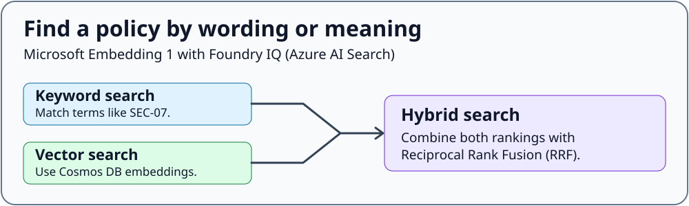

A question can name one policy but describe another. Use hybrid search to give both the policy code and the meaning of the question a vote. This recipe generates Microsoft Embedding 1 (preview) vectors through an **Azure Cosmos DB inference endpoint** and compares keyword, vector, and hybrid search across six fictional policies in **Foundry IQ (Azure AI Search)**.



**When to use:** Your application needs both exact terms and matches by meaning.  
**What it does:** Your application supplies embeddings to direct Search index and query APIs. It does not configure a Search vectorizer or use a Foundry IQ knowledge base.  
**How to adapt:** Evaluate the three modes on labeled questions before choosing a dimension or deciding whether to add semantic ranking.

**Difficulty:** Intermediate. **Time:** Allow about 20–40 minutes for first-time setup and role propagation and about 5 minutes to run the notebook once resources are ready. **Cost:** Eight embedding requests and six Search queries, plus two Search queries if you enable the optional semantic ranker. See [model pricing](https://learn.microsoft.com/azure/cosmos-db/gen-ai/microsoft-embedding-1#pricing) and [Search pricing](https://azure.microsoft.com/pricing/details/search/). A paid Search service can accrue charges even when idle.

**Last verified:** 2026-11-24

## Prerequisites

1. Use Python 3.10 or later. [Sign in with the Azure CLI](https://learn.microsoft.com/cli/azure/authenticate-azure-cli) and select the subscription for your test.
2. Register the inference provider in that subscription: `az provider register --namespace Microsoft.InferenceService --wait`. Ask a subscription administrator if you lack permission.
3. In the Azure Cosmos DB portal, open **AI Capabilities > Embedding generation (Preview)** and enable it in a [supported region](https://learn.microsoft.com/azure/cosmos-db/gen-ai/microsoft-embedding-1#model-specifications). See [Azure CLI and Bicep setup](https://learn.microsoft.com/azure/cosmos-db/gen-ai/generate-embedding#enable-embedding-generation) for alternatives. Copy the inference endpoint, not the database endpoint.
4. Choose a Foundry IQ (Azure AI Search) service with vector support and [role-based access enabled](https://learn.microsoft.com/azure/search/search-security-enable-roles). Basic is a starting point if you also want to try semantic ranking; verify feature availability and costs for your service.
5. Grant **Embedding User** on the companion inference account, and **Search Service Contributor** plus **Search Index Data Contributor** on the Search service, to the CLI identity. Allow time for assignment changes to propagate. The notebook does not create services or change roles.
6. Set `EMBEDDING_ENDPOINT` and `AZURE_SEARCH_ENDPOINT` before starting the kernel. If you use multiple Azure CLI subscriptions, optionally set `AZURE_SUBSCRIPTION_ID` to select the authorized subscription for both tokens. Install the tested dependencies in the notebook's Python environment:

   ```text
   python -m pip install "azure-data-ai==1.1.0b1" "azure-search-documents==12.0.0" "azure-identity==1.26.0"
   ```

## Configuration

Microsoft Embedding 1 [supports](https://learn.microsoft.com/azure/cosmos-db/gen-ai/microsoft-embedding-1#model-specifications) 1,024, 1,536, 2,048, and 2,560 dimensions (the model default). Start with 1,536: at the same precision it uses 40% less raw vector storage than 2,560. Measure the relevance tradeoff on your data. The [Azure Cosmos DB Blog announcement](https://devblogs.microsoft.com/cosmosdb/microsoft-embedding-one/) reports external benchmarks; this recipe does not reproduce them.

Run the numbered cells in order. A failure during setup or upload triggers cleanup. After upload, you can retry an embedding or query cell without rebuilding the index. Run Step 6 when you're done, even if a query fails.

```python
import math
import os
import time
import uuid
from contextlib import ExitStack, contextmanager

from azure.core import MatchConditions
from azure.core.exceptions import AzureError
from azure.data.ai import InferenceClient
from azure.identity import AzureCliCredential
from azure.search.documents import SearchClient
from azure.search.documents.indexes import SearchIndexClient
from azure.search.documents.indexes.models import (
    HnswAlgorithmConfiguration, HnswParameters, SearchField, SearchFieldDataType,
    SearchIndex, SearchableField, SemanticConfiguration, SemanticField,
    SemanticPrioritizedFields, SemanticSearch, SimpleField, VectorSearch, VectorSearchProfile,
)
from azure.search.documents.models import VectorizedQuery

MODEL = "microsoft-embedding-1-large"
DIMENSIONS = 1536
TEXT_ANALYZER = "en.microsoft"
TOP_K = 3
VECTOR_K = 50
SEMANTIC_CONFIG = "policy-text"
EMBEDDING_SCOPE = "https://dbinference.azure.com/.default"
SEARCH_SCOPE = "https://search.azure.com/.default"
EMBEDDING_ENDPOINT = os.environ.get("EMBEDDING_ENDPOINT")
SEARCH_ENDPOINT = os.environ.get("AZURE_SEARCH_ENDPOINT")
SUBSCRIPTION = os.environ.get("AZURE_SUBSCRIPTION_ID")
RUN_SEMANTIC = os.environ.get("RUN_SEMANTIC_RANKER", "0") == "1"

if "resources" in globals():
    resources.close()
resources = ExitStack()

@contextmanager
def setup_step():
    try:
        yield
    except BaseException as exc:
        resources.__exit__(type(exc), exc, exc.__traceback__)
        raise

print(f"Configuration: {DIMENSIONS} dimensions; top {TOP_K} results.")
```

## Step 0: Verify access

Check both token scopes and make a Search call without printing endpoints, tokens, or the names of existing indexes. A token proves sign-in, not permission to call the embedding endpoint; Step 1 tests that role.

```python
with setup_step():
    endpoints = {"EMBEDDING_ENDPOINT": EMBEDDING_ENDPOINT, "AZURE_SEARCH_ENDPOINT": SEARCH_ENDPOINT}
    missing = [name for name, value in endpoints.items() if not value]
    if missing:
        raise ValueError(f"Set {', '.join(missing)} before starting the kernel.")

    cli_options = {"subscription": SUBSCRIPTION} if SUBSCRIPTION else {}
    credential = resources.enter_context(AzureCliCredential(**cli_options))
    inference = resources.enter_context(InferenceClient(endpoint=EMBEDDING_ENDPOINT, credential=credential))
    index_client = resources.enter_context(SearchIndexClient(endpoint=SEARCH_ENDPOINT, credential=credential))
    credential.get_token(EMBEDDING_SCOPE)
    print("Embedding token OK.")
    credential.get_token(SEARCH_SCOPE)
    print("Search token OK.")
    next(iter(index_client.list_index_names()), None)
    print("Search index access OK.")
```

## Step 1: Embed one policy passage

The [model API](https://learn.microsoft.com/azure/cosmos-db/gen-ai/microsoft-embedding-1#api-reference) accepts one input per request. Use `kind="text"` for passages and `kind="query"` for questions; both use the same model and dimensions. Run the first passage on its own, then reuse its vector in Step 3 rather than paying to embed it twice.

```python
documents = [
    {"id": "travel", "policy_code": "TRV-12", "title": "Travel disruption expenses",
     "content": "When an air trip disruption leaves an employee stranded overnight, the company covers reasonable hotel and meal expenses. Submit receipts to the travel team within 30 days."},
    {"id": "baggage", "policy_code": "TRV-18", "title": "Lost baggage",
     "content": "Employees whose checked baggage is lost during business travel may claim essential replacement items with receipts."},
    {"id": "booking", "policy_code": "TRV-24", "title": "Changing a booking",
     "content": "Use the booking portal to change an itinerary when a business meeting moves. A manager must approve higher fares."},
    {"id": "equipment", "policy_code": "IT-04", "title": "Remote work equipment",
     "content": "Remote employees may request a laptop and monitor from the IT catalog; equipment must be returned when employment ends."},
    {"id": "leave", "policy_code": "HR-09", "title": "Annual leave",
     "content": "Employees request annual leave through the HR portal. Managers approve requests based on team coverage."},
    {"id": "security", "policy_code": "SEC-07", "title": "Lost devices",
     "content": "Report a lost company device to the security team within one day, even if it is recovered later."},
]

def embed_text(client, text: str, kind: str) -> tuple[list[float], int | None]:
    if kind not in {"text", "query"}:
        raise ValueError("Use text for passages or query for questions.")
    response = client.get_embeddings(
        model=MODEL, inputs=[{"kind": kind, "content": text}],
        vector_kind="dense", dimensions=DIMENSIONS, output_data_kind="float32",
        encoding_format="float", delivery="inline",
    )
    if response.output is not None or response.warnings or len(response.data or []) != 1:
        raise ValueError("Expected one inline embedding without warnings; check input length and model status.")
    item = response.data[0]
    vector = getattr(item, "embedding", None)
    if (
        getattr(item, "truncated", False) or not isinstance(vector, list) or len(vector) != DIMENSIONS
        or not all(type(value) in (int, float) and math.isfinite(value) for value in vector)
        or not any(vector)
    ):
        raise ValueError(f"Expected an untruncated, nonzero, finite vector with {DIMENSIONS} dimensions.")
    return vector, response.usage.prompt_tokens if response.usage else None

with setup_step():
    first_vector, first_tokens = embed_text(inference, documents[0]["content"], "text")
    print(f"First passage: {len(first_vector)} dimensions; input tokens: {first_tokens}.")
```

## Step 2: Create a temporary index

Use the [Microsoft English analyzer](https://learn.microsoft.com/azure/search/index-add-language-analyzers) for `title` and `content`. Use the keyword analyzer for `policy_code` so a code such as `TRV-18` stays a single term. Keep codes separate from the embedded prose. The cosine [vector field](https://learn.microsoft.com/azure/search/vector-search-how-to-create-index) matches the embedding dimensions and uses `stored=True` so Search can preserve vectors during partial updates.

```python
def make_index(name: str) -> SearchIndex:
    return SearchIndex(
        name=name,
        fields=[
            SimpleField(name="id", type=SearchFieldDataType.String, key=True),
            SearchableField(name="policy_code", type=SearchFieldDataType.String, analyzer_name="keyword"),
            SearchableField(name="title", type=SearchFieldDataType.String, analyzer_name=TEXT_ANALYZER),
            SearchableField(name="content", type=SearchFieldDataType.String, analyzer_name=TEXT_ANALYZER),
            SimpleField(name="embedding_model", type=SearchFieldDataType.String),
            SearchField(
                name="content_vector", type=SearchFieldDataType.Collection(SearchFieldDataType.Single),
                searchable=True, hidden=True, stored=True,
                vector_search_dimensions=DIMENSIONS, vector_search_profile_name="dense-profile",
            ),
        ],
        vector_search=VectorSearch(
            algorithms=[HnswAlgorithmConfiguration(name="hnsw-cosine", parameters=HnswParameters(metric="cosine"))],
            profiles=[VectorSearchProfile(name="dense-profile", algorithm_configuration_name="hnsw-cosine")],
        ),
        semantic_search=SemanticSearch(configurations=[SemanticConfiguration(
            name=SEMANTIC_CONFIG,
            prioritized_fields=SemanticPrioritizedFields(
                title_field=SemanticField(field_name="title"),
                content_fields=[SemanticField(field_name="content")],
            ),
        )]),
    )

def delete_owned_index(index_client, index):
    try:
        index_client.delete_index(index, match_condition=MatchConditions.IfNotModified)
    except AzureError as exc:
        raise RuntimeError(f"Could not delete {index.name}; verify ownership before manual cleanup.") from exc
    print("Temporary index deleted.")

with setup_step():
    index_name = f"embedding1-cookbook-{uuid.uuid4().hex[:12]}"
    print(f"Temporary index: {index_name}")
    try:
        created_index = index_client.create_index(make_index(index_name))
    except AzureError as exc:
        raise RuntimeError(f"Creation of {index_name} failed or is uncertain; verify ownership before manual cleanup.") from exc
    etag = created_index.e_tag
    if not isinstance(etag, str) or not etag.strip() or etag.strip() == "*":
        raise RuntimeError(f"No usable creation ETag for {index_name}; verify ownership before manual cleanup.")
    resources.callback(delete_owned_index, index_client, created_index)
    search = resources.enter_context(SearchClient(endpoint=SEARCH_ENDPOINT, index_name=index_name, credential=credential))
    print("Index created with text, policy-code, and vector fields.")
```

## Step 3: Upload the policies

Reuse the first vector and embed the other five policies. Check every upload result and wait for all six documents to be available before querying.

```python
with setup_step():
    passage_embeddings = [(first_vector, first_tokens)]
    passage_embeddings += [embed_text(inference, doc["content"], "text") for doc in documents[1:]]
    payload = [
        {**doc, "embedding_model": MODEL, "content_vector": vector}
        for doc, (vector, _) in zip(documents, passage_embeddings)
    ]
    uploaded = search.upload_documents(documents=payload)
    if len(uploaded) != len(payload) or any(not item.succeeded for item in uploaded):
        raise RuntimeError("At least one document upload failed; no query was run.")
    for attempt in range(30):
        count = search.get_document_count()
        if count == len(payload):
            break
        if attempt < 29:
            time.sleep(2)
    else:
        raise TimeoutError("Documents did not become searchable after 30 checks.")
    print(f"{len(uploaded)} uploaded; {count} searchable.")
```

## Step 4: Embed two questions

Embed both questions with `kind="query"`. The first asks about delayed-flight reimbursement with no policy code; `TRV-12` covers it. The second explicitly asks about `TRV-18` (lost baggage), even though its hotel wording points to `TRV-12`. For that question, judge relevance by whether the search retrieves the named policy, not the policy that covers hotels.

```python
queries = [
    ("Paraphrase", "Can I get reimbursed for a delayed flight?", None),
    ("Policy code", "Does TRV-18 cover hotel expenses after a delayed flight?", "TRV-18"),
]

query_embeddings = {label: embed_text(inference, question, "query") for label, question, _ in queries}
token_counts = [tokens for _, tokens in passage_embeddings] + [tokens for _, tokens in query_embeddings.values()]
print(f"Embedded {len(query_embeddings)} questions at {DIMENSIONS} dimensions.")
if all(tokens is not None for tokens in token_counts):
    print(f"Reported input tokens across all embedding requests: {sum(token_counts)}.")
else:
    print("Input token usage was not reported for every request; check Azure billing.")
```

## Step 5a: Run keyword search

Use the question for keyword search over the English text fields. If the application already knows a policy code, query that code in `policy_code` instead. Here the code is supplied with the sample question; a policy picker could provide it in an app. Keyword and hybrid search use the same lexical input.

```python
def keyword_args(question: str, code: str | None) -> dict:
    if code:
        return {"search_text": f'"{code}"', "search_fields": ["policy_code"]}
    return {"search_text": question, "search_fields": ["title", "content"]}

keyword = {
    label: list(search.search(**keyword_args(question, code), select=["id"], top=TOP_K))
    for label, question, code in queries
}
for label, hits in keyword.items():
    print(f"{label} keyword matches (up to {TOP_K}): {[hit['id'] for hit in hits]}")
```

## Step 5b: Run vector search

Use exhaustive cosine search for this tiny corpus. All vector and hybrid queries request the same number of vector candidates and display up to three hits. Compare IDs and ranks; don't compare scores across retrieval modes.

```python
def vector_query(vector: list[float]) -> VectorizedQuery:
    return VectorizedQuery(vector=vector, fields="content_vector", k_nearest_neighbors=VECTOR_K, exhaustive=True)

vector_hits = {}
for label, _, _ in queries:
    vector, _ = query_embeddings[label]
    hits = list(search.search(vector_queries=[vector_query(vector)], select=["id"], top=TOP_K))
    vector_hits[label] = hits
    print(f"{label} vector matches: {[hit['id'] for hit in hits]}")
```

## Step 5c: Run hybrid search

Send the same lexical input and the same vector used in the baselines. [Reciprocal Rank Fusion (RRF)](https://learn.microsoft.com/azure/search/hybrid-search-ranking) can lift a policy that appears in both lists. Compare the top hits: does adding the lexical signal move the named lost-baggage policy above the hotel policy, while still finding the policy for the paraphrase? This comparison illustrates a ranking tradeoff, not a relevance benchmark.

```python
def hybrid_search(search, question: str, vector: list[float], *, code: str | None = None,
                  semantic: bool = False) -> list[dict]:
    options = keyword_args(question, code)
    if semantic:
        options.update(semantic_query=question, semantic_configuration_name=SEMANTIC_CONFIG)
    return list(search.search(
        **options, vector_queries=[vector_query(vector)],
        select=["id", "policy_code", "title", "content"], top=TOP_K,
    ))

hybrid = {
    label: hybrid_search(search, question, query_embeddings[label][0], code=code)
    for label, question, code in queries
}

for label, question, _ in queries:
    print(question)
    for mode, results in (("Keyword", keyword), ("Vector", vector_hits), ("Hybrid", hybrid)):
        hits = results[label]
        top_id = hits[0]["id"] if hits else "(no match)"
        print(f"  {mode}: {top_id}")
    if hybrid[label]:
        hit = hybrid[label][0]
        print(f"  {hit['policy_code']}: {hit['title']}. {hit['content']}")
```

## Step 5d: Optionally add semantic ranking

Set `RUN_SEMANTIC_RANKER=1` before starting the kernel only if semantic ranking is already enabled and you're comfortable with its [separate billing](https://learn.microsoft.com/azure/search/semantic-how-to-enable-disable). Both hybrid calls use the same candidate settings, including the [recommended 50 vector candidates](https://learn.microsoft.com/azure/search/hybrid-search-how-to-query) for semantic ranking. The `semantic_query` adds the original question for reranking without changing the keyword or vector inputs. Reranking can move a different policy ahead of the code match; use a filter if that match is required.

```python
if RUN_SEMANTIC:
    for label, question, code in queries:
        vector, _ = query_embeddings[label]
        reranked = hybrid_search(search, question, vector, code=code, semantic=True)
        print(f"{label} after semantic ranking: {[hit['id'] for hit in reranked]}")
else:
    print("Semantic ranking skipped (opt-in).")
```

## Step 6: Clean up

Run this cell when you're done or if you stop after a query error. It deletes the temporary index and closes the Azure clients. If index ownership or deletion wasn't confirmed, verify ownership before manual cleanup.

```python
resources.close()
print("Azure clients closed.")
```

## Make it yours

Reuse `embed_text`, `keyword_args`, `vector_query`, and `hybrid_search` with the configuration values above. Keep the model, dimensions, and index metric consistent. Use hybrid when the lexical signal improves results on labeled questions; keep vector-only where it meets your needs.

| Sample choice | Change for your application |
| --- | --- |
| Six fictional policies | Chunk your documents. Inputs over 8,192 tokens can be truncated. Re-embed when text changes. |
| English analyzer and separate policy codes | Pick the language analyzer for your corpus. Pass a known code as the lexical input. For mandatory exact matches, make the code field filterable and use an equality filter; hybrid ranks matches but doesn't restrict the result set. |
| 1,536-dimensional float32 vectors | For this model, [`Collection(Edm.Half)`](https://learn.microsoft.com/azure/search/vector-search-how-to-assign-narrow-data-types) halves raw bytes per vector, not total index size. The [model produces float16 values natively](https://learn.microsoft.com/azure/cosmos-db/gen-ai/microsoft-embedding-1), so casting the widened float32 values back to float16 doesn't lose precision. |
| Exhaustive search, three displayed results | Measure approximate HNSW recall against exhaustive search on a labeled sample. Tune candidate count and query latency separately from the number of hits you display. |
| CLI identity for a local notebook | Use an explicitly configured managed identity in Azure and assign the same scoped roles. |

For larger corpora, bound concurrent embedding requests, respect `Retry-After`, and use [bounded Search upload batches](https://learn.microsoft.com/azure/search/search-how-to-large-index). Measure recall at your chosen `k`, latency, and total cost on labeled questions before deploying. For images or multi-vector output, see the [model documentation](https://learn.microsoft.com/azure/cosmos-db/gen-ai/microsoft-embedding-1); this recipe is text-only.

## Troubleshooting

| Symptom | Check |
| --- | --- |
| Inference setup fails | Register `Microsoft.InferenceService` and choose a supported region. |
| Embedding call returns 403 | Assign **Embedding User** on the companion inference account, not the Cosmos DB database account. Verify the signed-in identity. |
| Search returns 401 or 403 | Check the service endpoint, role-based access, and both Search roles. |
| Upload rejects vectors | Match the embedding dimensions and field type to the index definition. |
| Keyword results include unrelated policies | Inspect the terms produced by your language analyzer and evaluate a dedicated filter for literal codes. |
| Hybrid scores look small | RRF scores use a different scale from keyword and vector scores. |
| Semantic query fails with a plan or quota error | Skip the optional step or check the semantic ranker plan and remaining usage with the service owner. |
| Index creation or cleanup is uncertain | Verify ownership of the printed index before any manual deletion. |